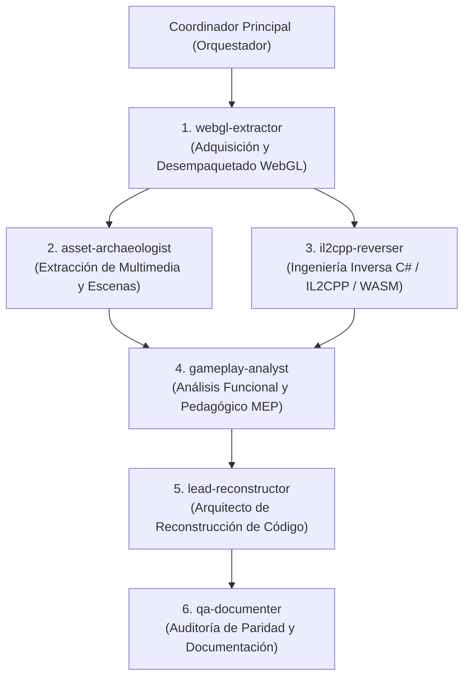

# Plan de Ingeniería Inversa y Reingeniería: *Costa Rica Pura Vida in Many Ways*

- **Recurso Objetivo:** https://recursos.mep.go.cr/costa-rica-pura-vida-in-many-ways/
- **Tecnología Original:** Unity WebGL (~2018)
- **Directorio de Implementación:** `c:\xampp\htdocs\costa_rica_puravida_in_many_ways\app`
- **Única Fuente de Verdad (Documentación):** `c:\xampp\htdocs\costa_rica_puravida_in_many_ways\app\docs`

---

## 1. Validación de Viabilidad Técnica (¿Es posible hacer Ingeniería Inversa?)

**Sí, es 100% viable.** Aunque no se cuente con el código fuente original de Unity (`.cs`, escenas `.unity` editables ni el proyecto original en el repositorio), las compilaciones **Unity WebGL de ~2018** empaquetan toda la información necesaria en el cliente web:

1. **Contenedor de Datos (`*.data.unityweb`):**
   - Es un paquete comprimido (Gzip o Brotli) con cabecera `UnityWebData1.0`.
   - Al desempaquetarlo se obtiene el sistema de archivos interno de Unity (`globalgamemanagers`, `resources.assets`, `sharedassets0.assets`, `level0`, `level1`, etc.).
   - De aquí es posible recuperar el **100% de los recursos originales**: sprites, texturas (PNG), audios/locuciones en inglés (WAV/OGG/MP3), fuentes tipográficas, animaciones, `TextAssets` (archivos JSON/XML/texto con preguntas y diálogos) y la jerarquía completa de objetos de cada escena (`Transform`, `MonoBehaviour`, `Canvas`, UI).

2. **Metadatos de Código C# (`global-metadata.dat`):**
   - Unity WebGL compila el código C# a C++ y luego a WebAssembly (`.wasm`) o `asm.js` mediante **IL2CPP**.
   - Sin embargo, IL2CPP necesita incluir el archivo `Data/il2cpp_data/Metadata/global-metadata.dat` dentro del paquete de datos para resolver tipos en tiempo de ejecución.
   - Este archivo conserva **todos los nombres originales de las clases C#, namespaces, nombres de métodos, campos, propiedades y literales de texto (strings)**.

3. **Binario de Lógica (`*.wasm.code.unityweb` / `*.asm.code.unityweb`):**
   - Cruzando `global-metadata.dat` con el binario WebAssembly mediante herramientas como **Il2CppDumper**, **AssetRipper**, **UnityPy** y descompiladores WASM (`wasm-decompile` / `wasm2wat` / Ghidra), se reconstruye el flujo exacto de cada script C#, las reglas de los minijuegos, el sistema de monedas y las validaciones pedagógicas.

---

## 2. Propuesta del Equipo de Trabajo de Subagentes

Para ejecutar esta prueba de ingeniería inversa de forma ordenada, modular y trazable, proponemos una arquitectura de **6 subagentes especializados** coordinados por el agente principal:

### Detalle de Roles y Responsabilidades

| # | Identificador del Subagente | Rol | Responsabilidad Principal | Entregables en el Proyecto |
| :-: | :--- | :--- | :--- | :--- |
| **1** | `webgl-extractor` | **Especialista en Adquisición y Desempaquetado WebGL** | Descargar del servidor del MEP el `index.html`, manifiestos `.json`, scripts `UnityLoader.js` y binarios `.unityweb`. Descomprimir el contenedor `UnityWebData1.0` para extraer los archivos internos crudos de Unity. | `/raw_build/` y `/unpacked_data/` + informe de estructura del build y versión exacta de Unity. |
| **2** | `asset-archaeologist` | **Arqueólogo de Recursos Multimedia y Escenas** | Procesar los archivos `.assets` y `level*` (usando `UnityPy` / `AssetRipper`) para extraer y clasificar sprites, fondos de las provincias, audios, locuciones, fuentes, textos y jerarquías de escenas/UI. | `/extracted_assets/` (organizado por `Sprites/`, `Audio/`, `Fonts/`, `Scenes/`, `TextAssets/`) + catálogo completo de recursos. |
| **3** | `il2cpp-reverser` | **Analista de Lógica IL2CPP y WebAssembly** | Procesar `global-metadata.dat` y el binario `.wasm`/`.asm.js` para recuperar todas las firmas de clases C#, métodos, variables de estado, diccionarios de preguntas y lógica algorítmica de los minijuegos. | `/reverse_code/` (`dump.cs`, mapeo de clases, pseudocódigo de controladores y máquinas de estado). |
| **4** | `gameplay-analyst` | **Analista Funcional y Pedagógico** | Mapear el flujo completo del juego (*Amazing Costa Rica*: recorrido por provincias, atractivos turísticos, sistema de monedas y minijuegos de inglés) cruzando el comportamiento en vivo con los datos extraídos. | `/docs/02_especificacion_funcional_y_flujos.md` (Documento de Diseño Inverso - GDD). |
| **5** | `lead-reconstructor` | **Arquitecto de Reconstrucción y Modernización** | Reconstruir el código fuente limpio y mantenible utilizando los assets originales extraídos y la lógica recuperada en el stack acordado: **React + JavaScript + Vite + Tailwind CSS + JSON** (100% client-side, sin base de datos ni backend). | `/src/` (Aplicación React + Vite + Tailwind + JSON completa, modular y lista para control de versiones en Git). |
| **6** | `qa-documenter` | **Auditor de Calidad, Paridad y Documentación** | Validar que cada pantalla, audio, minijuego y regla pedagógica coincida con el juego original de 2018, y consolidar la documentación técnica en el repositorio. | `/docs/` actualizados, matriz de paridad 1:1 y manual de despliegue/mantenimiento. |

---

## 3. Fases de Ejecución Propuestas

1. **Fase 1 — Adquisición y Desempaquetado (`webgl-extractor`):** Descarga de los archivos públicos del juego desde `recursos.mep.go.cr` y apertura del contenedor `.unityweb`.
2. **Fase 2 — Extracción Paralela (`asset-archaeologist` + `il2cpp-reverser`):** Recuperación simultánea de todos los archivos multimedia (imágenes, sonidos, textos) y de la estructura de clases/lógica C# (`global-metadata.dat`).
3. **Fase 3 — Especificación y GDD Inverso (`gameplay-analyst` + `qa-documenter`):** Documentación detallada de cada escena, provincia y minijuego.
4. **Fase 4 — Reconstrucción del Código Fuente (`lead-reconstructor`):** Creación del proyecto con código fuente limpio y moderno a partir de todo lo recuperado.
