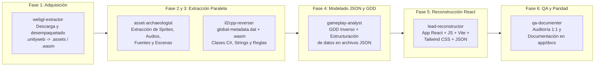

# Plan de Ejecución de Ingeniería Inversa y Reingeniería Web

- **Proyecto:** *Costa Rica Pura Vida in Many Ways* (MEP)
- **URL Origen (Unity WebGL ~2018):** https://recursos.mep.go.cr/costa-rica-pura-vida-in-many-ways/
- **Stack Destino:** **React + JavaScript + Vite + Tailwind CSS + JSON** (100% Client-Side, sin Base de Datos ni Backend)
- **Ubicación de este Plan:** `c:\xampp\htdocs\costa_rica_puravida_in_many_ways\app\docs\02_PLAN_EJECUCION_REINGENIERIA.md`

---

## 1. Visión General del Flujo de Trabajo

El plan se divide en **6 Fases secuenciales y paralelizables**, ejecutadas por nuestro equipo de subagentes para transformar el binario cerrado de Unity WebGL 2018 en una aplicación **React + Vite + Tailwind + JSON** de alto rendimiento:



---

## 2. Detalle de Fases y Tareas

### Fase 1: Adquisición Forense y Desempaquetado WebGL
- **Subagente Responsable:** `webgl-extractor`
- **Objetivo:** Obtener localmente todos los artefactos publicados en el servidor del MEP y abrir el contenedor empaquetado de Unity.
- **Pasos de Ejecución:**
  1. Inspeccionar `https://recursos.mep.go.cr/costa-rica-pura-vida-in-many-ways/` (`index.html`, scripts de carga y manifiesto JSON de compilación).
  2. Descargar en `app/reverse_engineering/raw_build/` los paquetes `.unityweb` (`*.data.unityweb`, `*.wasm.code.unityweb`, `*.wasm.framework.unityweb`) y cualquier archivo dentro de `StreamingAssets/` o `TemplateData/`.
  3. Descomprimir el paquete `*.data.unityweb` (Gzip/Brotli) y parsear la cabecera `UnityWebData1.0` para extraer en `app/reverse_engineering/unpacked_data/` los archivos internos crudos:
     - `globalgamemanagers` / `data.unity3d`
     - `level0`, `level1`, ... (escenas del juego)
     - `sharedassets0.assets`, `resources.assets`, ... (contenedores multimedia)
     - `Il2CppData/Metadata/global-metadata.dat` (símbolos y metadatos C#)
- **Entregable en `app/docs/`:** Reporte técnico de la estructura del build y versión exacta de Unity.

---

### Fase 2: Arqueología y Extracción de Recursos Multimedia
- **Subagente Responsable:** `asset-archaeologist`
- **Objetivo:** Recuperar el 100% de las imágenes, recortes de sprites, locuciones en inglés, música, efectos de sonido, fuentes y jerarquías visuales.
- **Pasos de Ejecución:**
  1. Ejecutar scripts de extracción con **UnityPy** sobre todos los archivos `.assets` y `level*`.
  2. Exportar y organizar todos los activos en `app/reverse_engineering/extracted_assets/` (listos para moverse luego a `app/public/assets/`):
     - **`sprites/` y `textures/`:** Fondos de las 7 provincias, mapas, personajes, botones de UI, íconos de monedas, insignias y elementos de cada minijuego en formato PNG transparente.
     - **`audio/`:** Locuciones educativas en inglés (instrucciones, vocabulario, diálogos), música de fondo y efectos de sonido (acierto, error, clic, ganar monedas).
     - **`fonts/`:** Fuentes tipográficas originales (`.ttf` / `.otf`).
     - **`text_assets/` y `scenes/`:** Volcado en JSON de la jerarquía de objetos (`GameObject`, `RectTransform`, posiciones UI, componentes `MonoBehaviour` y textos estáticos de cada escena).
- **Entregable en `app/docs/`:** Catálogo e inventario completo de recursos multimedia recuperados.

---

### Fase 3: Ingeniería Inversa de Código y Lógica (IL2CPP + WASM)
- **Subagente Responsable:** `il2cpp-reverser`
- **Objetivo:** Recuperar todas las clases C#, métodos, estados del juego, textos internos y reglas de programación compiladas en el binario.
- **Pasos de Ejecución:**
  1. Analizar `global-metadata.dat` junto con `*.wasm.code.unityweb` (mediante `Il2CppDumper` y analizadores binarios en Python) para extraer:
     - Todas las clases, namespaces, métodos y propiedades de los scripts originales de los desarrolladores (excluyendo librerías base de Unity).
     - Todos los literales de texto (`string literals`): bancos de preguntas, respuestas correctas/incorrectas, diálogos culturales por provincia, instrucciones y claves de `PlayerPrefs`.
  2. Reconstruir el flujo algorítmico de:
     - Sistema de progreso y economía de monedas virtuales (cuántas monedas da cada actividad y cuánto cuesta desbloquear cada experiencia turística).
     - Reglas, puntajes, tiempos y condiciones de victoria/derrota de cada minijuego.
- **Entregable en `app/docs/`:** Documento técnico de arquitectura lógica original y volcado estructurado de clases y strings.

---

### Fase 4: Especificación Funcional (GDD Inverso) y Arquitectura de Datos JSON
- **Subagente Responsable:** `gameplay-analyst`
- **Objetivo:** Convertir toda la información recuperada en las Fases 2 y 3 en un **Documento de Diseño Inverso (GDD)** y en una colección de archivos **JSON** puros que alimentarán la aplicación React sin necesidad de base de datos.
- **Pasos de Ejecución:**
  1. Documentar el mapa completo de pantallas y navegación:
     - Pantalla de bienvenida / instrucciones / selección de personaje o perfil local.
     - Mapa general de Costa Rica y sus provincias (*San José, Alajuela, Cartago, Heredia, Guanacaste, Puntarenas, Limón*).
     - Flujo dentro de cada provincia: información cultural/turística, locuciones, minijuegos y actividades recompensadas con monedas.
  2. Diseñar y poblar los archivos **JSON** maestros (que vivirán en `app/src/data/`):
     - `gameConfig.json`: Configuración global, economía de monedas inicial, reglas de puntuación y rutas de audio/sprites.
     - `provinces.json`: Datos de las 7 provincias, atractivos turísticos, descripciones, audios asociados y coordenadas en el mapa.
     - `minigames.json`: Configuración detallada de cada minijuego, mecánicas, niveles de dificultad, bancos de preguntas/ítems, respuestas válidas y retroalimentación pedagógica.
     - `dialogues.json` / `vocabulary.json`: Textos, diálogos y glosarios vinculados a sus archivos de audio correspondientes.
- **Entregable en `app/docs/`:** `03_GDD_INVERSO_Y_ESQUEMAS_JSON.md`.

---

### Fase 5: Reconstrucción Moderna en React + JavaScript + Vite + Tailwind CSS + JSON
- **Subagente Responsable:** `lead-reconstructor`
- **Objetivo:** Construir la aplicación educativa moderna, rápida, modular y 100% libre de backend/base de datos dentro de `app/`.
- **Arquitectura Propuesta del Proyecto (`app/`):**
  ```text
  app/
  ├── AGENTS.md
  ├── docs/                        # Única fuente de verdad (Documentación y MEMORY.md)
  ├── public/
  │   └── assets/                  # Activos originales extraídos (sprites, audio, fonts)
  ├── src/
  │   ├── data/                    # Toda la base de conocimiento en JSON puro (Sin DB)
  │   │   ├── gameConfig.json
  │   │   ├── provinces.json
  │   │   ├── minigames.json
  │   │   └── dialogues.json
  │   ├── context/
  │   │   ├── GameContext.jsx      # Estado global (monedas, progreso, desbloqueos + localStorage)
  │   │   └── AudioContext.jsx     # Motor de sonido Web Audio API (música, SFX y voces en inglés)
  │   ├── components/
  │   │   ├── layout/              # Contenedor responsivo 16:9, HUD de monedas, barra de navegación
  │   │   ├── screens/             # Splash, Menú Principal, Mapa de Costa Rica, Vista de Provincia
  │   │   ├── minigames/           # Componentes modulares en React/Tailwind para cada minijuego
  │   │   └── ui/                  # Modales, cuadros de diálogo, botones animados, reproductor de voz
  │   ├── hooks/                   # Hooks personalizados (useGameData, useAudio, useMinigameEngine)
  │   ├── App.jsx
  │   └── main.jsx
  ├── index.html
  ├── package.json
  ├── tailwind.config.js
  └── vite.config.js
  ```
- **Características Potenciadas del Nuevo Stack:**
  - **Cero Base de Datos / 100% JSON-Driven:** Todos los textos, preguntas, audios y reglas se leen directamente de `src/data/*.json`, permitiendo mantenimiento inmediato y carga instantánea.
  - **Persistencia Inteligente Client-Side:** Uso de `localStorage` con exportación/importación opcional de partida en JSON para que el estudiante no pierda sus monedas ni su avance al cerrar el navegador.
  - **Carga Instantánea y Responsividad con Tailwind CSS:** A diferencia de Unity WebGL (que tarda en descargar e inicializar decenas de megabytes de WebAssembly en memoria), Vite + React + Tailwind carga al instante y funciona fluido en PCs escolares de bajos recursos, tablets y pizarras interactivas.

---

### Fase 6: Auditoría de Paridad 1:1, Pruebas y Documentación Final
- **Subagente Responsable:** `qa-documenter`
- **Objetivo:** Certificar que ningún detalle pedagógico, visual o auditivo del juego original de 2018 se haya quedado por fuera.
- **Pasos de Ejecución:**
  1. Ejecutar matriz de verificación escena por escena y minijuego por minijuego contra el build original.
  2. Verificar que todos los audios en inglés y efectos de sonido se disparen en los momentos exactos.
  3. Validar el empaquetado de producción (`npm run build`) asegurando rutas relativas limpias para su publicación directa en `recursos.mep.go.cr`.
  4. Actualizar `app/docs/MEMORY.md` y el manual técnico de mantenimiento.

---

## 3. Orden de Arranque Inmediato (Siguiente Paso)

Si apruebas este plan, iniciaremos de inmediato con la **Fase 1 (`webgl-extractor`)** y **Fase 2/3 (`asset-archaeologist` + `il2cpp-reverser`)**:
1. Conectarnos a `https://recursos.mep.go.cr/costa-rica-pura-vida-in-many-ways/` para descargar los archivos del build de Unity WebGL.
2. Desempaquetar los binarios `.unityweb`.
3. Extraer todas las escenas, sprites, audios y el código/metadatos C# (`global-metadata.dat`) y documentar los hallazgos reales en `app/docs/`.
