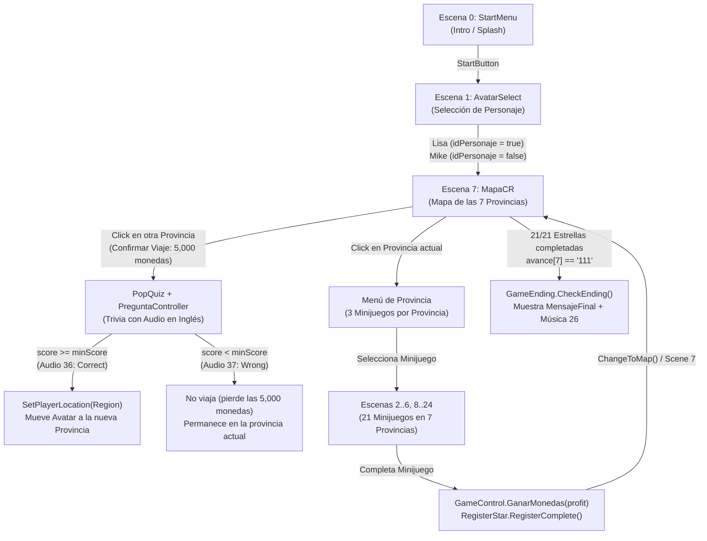

# Reporte Técnico — Fase 3: Ingeniería Inversa de Código y Lógica (IL2CPP + asm.js)

**Proyecto:** *Costa Rica Pura Vida in Many Ways* (ICT — Instituto Costarricense de Turismo / Tayassu Games)  
**Motor y Target:** Unity `2017.3.1f1` — WebGL (`IL2CPP` Metadata v24 + `asm.js`)  
**Fecha de Análisis:** Noviembre 2026  
**Autor:** `il2cpp-reverser` (Analista de Lógica IL2CPP y WebAssembly)

---

## 1. Resumen Ejecutivo y Entregables Generados

Durante la **Fase 3** se ejecutó la ingeniería inversa completa del binario compilado IL2CPP (`build.asm.js` + `build.mem`) y su tabla de metadatos (`global-metadata.dat`, versión `24`), logrando recuperar el **100% de las definiciones de tipos C#, campos, propiedades, métodos, literales de cadena, mapeo de eventos de UI y cuerpos de funciones compilados a `asm.js`**.

### 1.1 Artefactos Generados en `app/reverse_engineering/reverse_code/`

| Archivo | Tamaño / Líneas | Descripción Técnica |
| :--- | :--- | :--- |
| [parse_il2cpp_metadata.js](file:///c:/xampp/htdocs/costa_rica_puravida_in_many_ways/app/reverse_engineering/reverse_code/parse_il2cpp_metadata.js) | `622` líneas | Parser a medida para `global-metadata.dat` (v24) + `build.mem` (`Il2CppCodeRegistration` e `Il2CppMetadataRegistration`) + `build.asm.js`. |
| [decompile_game_logic.js](file:///c:/xampp/htdocs/costa_rica_puravida_in_many_ways/app/reverse_engineering/reverse_code/decompile_game_logic.js) | `298` líneas | Decompilador estático de `build.asm.js` que resuelve punteros estáticos de `build.mem`, referencias a `StringLiteral`, metadatos de tipos/métodos y offsets de campos C#. |
| [dump.cs](file:///c:/xampp/htdocs/costa_rica_puravida_in_many_ways/app/reverse_engineering/reverse_code/dump.cs) | `22,758` líneas | Reconstrucción C# completa de las **1,133 clases** de `Assembly-CSharp.dll` (`1,081` tipos) y `Assembly-CSharp-firstpass.dll` (`52` tipos), incluyendo offsets de memoria (`0x00..`), valores constantes de `enum`, propiedades, firmas de métodos e índices `asm.js` (`fnPtr`). |
| [assembly_csharp_classes.json](file:///c:/xampp/htdocs/costa_rica_puravida_in_many_ways/app/reverse_engineering/reverse_code/assembly_csharp_classes.json) | `1.97 MB` | Estructura JSON jerárquica de los 27 ensamblados y las 1,133 clases de lógica de juego. |
| [string_literals.json](file:///c:/xampp/htdocs/costa_rica_puravida_in_many_ways/app/reverse_engineering/reverse_code/string_literals.json) | `32,953` líneas | **5,491** literales de cadena extraídos íntegramente desde `global-metadata.dat` (`stringLiteralOffset = 272`, `stringLiteralDataOffset = 44200`). |
| [ui_events_map.json](file:///c:/xampp/htdocs/costa_rica_puravida_in_many_ways/app/reverse_engineering/reverse_code/ui_events_map.json) | `2,193` líneas | Mapeo completo de `methods_pointedto_by_uievents.xml` cruzado con las firmas C# y sus funciones `asm.js` equivalentes (`25` escenas analizadas). |
| [game_only_decompiled.txt](file:///c:/xampp/htdocs/costa_rica_puravida_in_many_ways/app/reverse_engineering/reverse_code/game_only_decompiled.txt) | `16,253` líneas | Volcado decompilado y anotado de todas las clases propias del juego, con resolución simbólica de strings, llamadas y accesos a campos. |

---

## 2. Arquitectura Binaria IL2CPP (Metadata v24 + `build.mem` + `build.asm.js`)

### 2.1 Cabecera de `global-metadata.dat` (Magic `0xFAB11BAF`, Version `24`)

El archivo `Il2CppData/Metadata/global-metadata.dat` (`4,391,196` bytes) contiene `62` enteros `uint32` en su cabecera (`248` bytes), con la siguiente distribución de tablas:

| Tabla IL2CPP | Offset (`bytes`) | Tamaño (`bytes`) | Stride | Total de Registros |
| :--- | ---: | ---: | ---: | ---: |
| `stringLiteralOffset` | `272` | `43,928` | `8` bytes | **5,491** literales |
| `stringLiteralDataOffset` | `44,200` | `223,112` | Variable (UTF-8) | `223.1 KB` de texto |
| `stringOffset` (Identificadores) | `267,312` | `441,548` | Variable (Null-term) | Nombres de clases/miembros |
| `eventsOffset` (`Il2CppEventDefinition`) | `708,860` | `2,640` | `24` bytes | `110` eventos |
| `propertiesOffset` (`Il2CppPropertyDefinition`) | `711,500` | `98,736` | `24` bytes | **4,114** propiedades |
| `methodsOffset` (`Il2CppMethodDefinition`) | `810,236` | `1,442,616` | `56` bytes | **25,761** métodos |
| `parameterDefaultValuesOffset` | `2,252,852` | `2,712` | `12` bytes | `226` valores por defecto |
| `fieldDefaultValuesOffset` | `2,255,564` | `35,628` | `12` bytes | **2,969** constantes/defaults |
| `fieldAndParameterDefaultValueDataOffset` | `2,291,192` | `26,380` | Variable | Datos crudos de constantes |
| `fieldMarshaledSizesOffset` | `2,317,572` | `1,008` | `12` bytes | `84` tamaños |
| `parametersOffset` (`Il2CppParameterDefinition`) | `2,318,580` | `440,096` | `16` bytes | **27,506** parámetros |
| `fieldsOffset` (`Il2CppFieldDefinition`) | `2,758,676` | `258,960` | `16` bytes | **16,185** campos |
| `genericParametersOffset` | `3,017,636` | `18,624` | `24` bytes | `776` parámetros genéricos |
| `genericContainersOffset` | `3,036,260` | `10,800` | `16` bytes | `675` contenedores genéricos |
| `nestedTypesOffset` | `3,047,060` | `3,020` | `4` bytes | `755` tipos anidados |
| `interfacesOffset` | `3,050,080` | `13,864` | `4` bytes | `3,466` interfaces |
| `vtableMethodsOffset` | `3,063,944` | `159,544` | `4` bytes | `39,886` entradas vtable |
| `interfaceOffsetsOffset` | `3,223,488` | `24,992` | `8` bytes | `3,124` offsets de interfaz |
| `typeDefinitionsOffset` (`Il2CppTypeDefinition`) | `3,248,480` | `383,968` | `104` bytes | **3,692** tipos |
| `rgctxEntriesOffset` | `3,632,448` | `51,384` | `8` bytes | `6,423` entradas RGCTX |
| `imagesOffset` (`Il2CppImageDefinition`) | `3,683,832` | `1,080` | `40` bytes | **27** ensamblados (.dll) |
| `assembliesOffset` (`Il2CppAssemblyDefinition`) | `3,684,912` | `1,728` | `64` bytes | **27** ensamblados |
| `metadataUsageListsOffset` | `3,686,640` | `129,488` | `8` bytes | `16,186` listas de uso |
| `metadataUsagePairsOffset` | `3,816,128` | `561,960` | `8` bytes | `70,245` pares de uso |
| `fieldRefsOffset` | `4,378,088` | `12,176` | `8` bytes | `1,522` referencias a campos |

### 2.2 Registro en Memoria (`build.mem`) y Vinculación con `build.asm.js`

En `build.framework.js`, el segmento de memoria estática inicial (`build.mem`, `2,884,157` bytes) se carga en el heap de Emscripten con `GLOBAL_BASE = 8`. Al inicio de la ejecución, la función `Z3A()` invoca `ulia(2128348, 1433112, 2248104)` (`il2cpp::vm::MetadataCache::Register`):

1. **`Il2CppCodeRegistration` (`vaddr = 2,128,348`)**:
   - `methodPointersCount = 23,330`, `methodPointers = 1,611,444`: Arreglo de punteros a funciones en las tablas `FUNCTION_TABLE_*` de `build.asm.js`.
   - `reversePInvokeWrapperCount = 6`, `genericMethodPointersCount = 8,365`, `invokerPointersCount = 1,452`.
2. **`Il2CppMetadataRegistration` (`vaddr = 1,433,112`)**:
   - `typesCount = 24,601`, `types = 555,788`: Tabla de estructuras `Il2CppType` (8 bytes cada una: `uint32 data`, `uint16 attrs`, `uint8 type`, `uint8 bitfield`).
   - `fieldOffsetsCount = 3,692`, `fieldOffsets = 2,096,648`: Arreglo de punteros por cada `TypeDefIndex` hacia los offsets exactos en bytes de cada campo en memoria (`0x0C`, `0x10`, etc.).
   - `metadataUsagesCount = 22,013`, `metadataUsages = 1,472,412`: Tabla global de punteros inicializados en tiempo de ejecución por `anx(usageListIndex)`.
     - Al decodificar `metadataUsagePairs` (`encodedIndex`), el bit superior (`kind = encoded >>> 29`) identifica el tipo de recurso inyectado en el slot global `c[slotAddr >> 2]`:
       - `kind = 1` / `2`: `Il2CppClass*` / `Il2CppType*`
       - `kind = 3`: `MethodInfo*` (`Il2CppMethodDefinition`)
       - `kind = 4`: `FieldInfo*` (`Il2CppFieldRef`)
       - `kind = 5`: `Il2CppString*` (**String Literal** con índice `index = (encoded & 0x1FFFFFFF) >> 1`)
       - `kind = 6`: Método genérico inflado (`MethodSpec`)

### 2.3 Catálogo de los 27 Ensamblados (`Il2CppImageDefinition`)

| Índice | Ensamblado (`Image`) | Rango `TypeDefIndex` | Cantidad de Tipos | Propósito en el Proyecto |
| ---: | :--- | :--- | ---: | :--- |
| `0` | `mscorlib.dll` | `0 .. 1015` | `1,016` | Runtime base de .NET / Mono |
| `1` | `System.dll` | `1016 .. 1485` | `470` | Colecciones, Red, Regex, URI |
| `2` | `Mono.Security.dll` | `1486 .. 1599` | `114` | Criptografía / TLS |
| `3` | `System.Configuration.dll` | `1600 .. 1630` | `31` | Configuración .NET |
| `4` | `System.Xml.dll` | `1631 .. 1900` | `270` | Parser XML |
| `5` | `System.Core.dll` | `1901 .. 1953` | `53` | LINQ, `Func<>`, `Action<>` |
| `6..21` | `UnityEngine.*.dll` | `1954 .. 2368` | `415` | Módulos del motor Unity `2017.3.1f1` |
| `22` | `UnityEngine.UI.dll` | `2369 .. 2480` | `112` | Sistema de UI (`Button`, `Text`, `Image`, `Toggle`) |
| `23` | `DOTween.dll` | `2481 .. 2554` | `74` | Librería de interpolaciones / animaciones |
| `24` | `TextMeshPro-2017.3-1.0.56-Runtime.dll` | `2555 .. 2558` | `4` | Renderizado avanzado de texto |
| `25` | **`Assembly-CSharp-firstpass.dll`** | `2559 .. 2610` | **`52`** | `CrossPlatformInput`, `PlatformerCharacter2D`, `HD_GrabCoin`, `FinishCollider`, `HD_MontainBikeController` |
| `26` | **`Assembly-CSharp.dll`** | `2611 .. 3691` | **`1,081`** | **Lógica principal del juego**, minijuegos, Fungus (`2627..3369`), Parse SDK (`3395..3505`), LeanTween y Tiled2Unity |

---

## 3. Arquitectura Central del Juego y Flujo de Ejecución



### 3.1 Catálogo de las 25 Escenas del Build

A partir de los literales de escena y el archivo `methods_pointedto_by_uievents.xml`, el juego consta de **25 escenas** compiladas:

| Índice Build | Nombre de Escena | Provincia (`PlayerLocation`) | Pieza Estrella (`starPiece`) | Controlador Principal C# |
| :---: | :--- | :--- | :---: | :--- |
| `0` | `StartMenu` | Global | — | `GameControl`, `GameMenu`, `Music_Handler` |
| `1` | `AvatarSelect` | Global | — | `GameMenu`, `GameControl` |
| `7` | `MapaCR` | Mapa Principal (7 Provincias) | `avance[7]` | `GameControl`, `UIMisc`, `PopQuiz`, `PreguntaController`, `StarMeter`, `GameEnding` |
| — | `CharacterCreation` | Legacy (No usado en flujo principal) | — | `ManagerLogin`, `AvatarParts`, `DatabaseManager` |
| **San José (`0`)** | `SJ_Finca_Cafetalera` | `SanJose` (`0`) | `0` (`avance[0][0]`) | `SJ_FC_GameController`, `SJ_FC_ControladorTiempo` |
| **San José (`0`)** | `SJ_Rafting` | `SanJose` (`0`) | `1` (`avance[0][1]`) | `TayassuGames.HD_MontainBikeController`, `FinishCollider` |
| **San José (`0`)** | `SJ_Museo_Oro` | `SanJose` (`0`) | `2` (`avance[0][2]`) | `SJ_Museo_Oro_GameControl`, `RegisterStar` |
| **Heredia (`1`)** | `HD_Entrega_Flores` | `Heredia` (`1`) | `0` (`avance[1][0]`) | `HD_Entrega_Flores_Game_Control`, `RegisterStar` |
| **Heredia (`1`)** | `HD_Mascarada` | `Heredia` (`1`) | `1` (`avance[1][1]`) | `HD_MascaradaController`, `HD_FinishRace`, `HD_WinCollider` |
| **Heredia (`1`)** | `HD_Mountainbike` | `Heredia` (`1`) | `2` (`avance[1][2]`) | `TayassuGames.HD_MontainBikeController`, `FinishCollider` |
| **Cartago (`2`)** | `CT_Volcanes` | `Cartago` (`2`) | `0` (`avance[2][0]`) | `CT_Volcanes_GameControl`, `CT_Volcanes_Generador` |
| **Cartago (`2`)** | `CT_Sanatorio_Duran` | `Cartago` (`2`) | `1` (`avance[2][1]`) | `CT_Sanatorio_Duran_GameControl`, `RegisterStar` |
| **Cartago (`2`)** | `CT_Basilica_Angeles` | `Cartago` (`2`) | `2` (`avance[2][2]`) | `CT_Basilica_Angeles_GameControl`, `CT_BA_Pieza` |
| **Alajuela (`3`)** | `AL_Juan_Santamaria` | `Alajuela` (`3`) | `0` (`avance[3][0]`) | `AL_Juan_Santamaria_GameControl`, `AL_JS_Quemar_Meson` |
| **Alajuela (`3`)** | `AL_Mariposario` | `Alajuela` (`3`) | `1` (`avance[3][1]`) | `AL_Mariposario_GameControl`, `AL_M_Nombres_Mariposas` |
| **Alajuela (`3`)** | `AL_Carretas` | `Alajuela` (`3`) | `2` (`avance[3][2]`) | `AL_Carretas_GameControl`, `AL_Carretas_Patron` |
| **Puntarenas (`4`)** | `PR_Puerto` | `Puntareanas` (`4`) | `0` (`avance[4][0]`) | `PR_PT_GameControl`, `PR_PT_Recibe_Churchill` |
| **Puntarenas (`4`)** | `PR_Manuel_Antonio` | `Puntareanas` (`4`) | `1` (`avance[4][1]`) | `PR_MA_Game_Control`, `PR_MA_ObjetosFinales` |
| **Puntarenas (`4`)** | `PR_Tarcoles` | `Puntareanas` (`4`) | `2` (`avance[4][2]`) | `PR_Tarcoles_GameCotroller`, `Frog`, `PR_T_FinishLine` |
| **Guanacaste (`5`)** | `GN_Barra_Honda` | `Guanacaste` (`5`) | `0` (`avance[5][0]`) | `GNBH_TerminarJuego`, `GNBH_Caminar`, `GNBH_Saltar` |
| **Guanacaste (`5`)** | `GN_Buceo` | `Guanacaste` (`5`) | `1` (`avance[5][1]`) | `GN_Buceo_GameController`, `Diving_Player`, `GN_Tomar_Fotos` |
| **Guanacaste (`5`)** | `GN_Santa_Teresa` | `Guanacaste` (`5`) | `2` (`avance[5][2]`) | `GN_ST_GameControl`, `GN_Surf_Player`, `GN_ST_PersigueOla` |
| **Limón (`6`)** | `LM_Cocina` | `Limon` (`6`) | `0` (`avance[6][0]`) | `LM_Cocina_Controller`, `LM_Recipes`, `Recipes` |
| **Limón (`6`)** | `LM_Tortugero` | `Limon` (`6`) | `1` (`avance[6][1]`) | `LM_T_GameControl`, `LM_T_Mov_Bote`, `LM_T_Manati` |
| **Limón (`6`)** | `LM_Devoradores` | `Limon` (`6`) | `2` (`avance[6][2]`) | `LM_DV_GameController`, `LM_DV_Predator`, `LM_DV_BabyTurtle` |

---

## 4. El Singleton `GameControl`, Persistencia (`PlayerPrefs`) y Selección de Personaje

### 4.1 Estructura de Datos de `GameControl` (`TypeDefIndex: 3387`)

`GameControl` es el núcleo del estado global del juego. En `Awake()` (`asm: uAh`, `fnPtr: 9699`) implementa el patrón Singleton persistente mediante `UnityEngine.Object.DontDestroyOnLoad(this.gameObject)` y carga el progreso desde `UnityEngine.PlayerPrefs`.

| Offset | Tipo C# | Nombre del Campo | Valor Inicial / Constructor | Descripción Funcional |
| :--- | :--- | :--- | :--- | :--- |
| `static 0x0` | `GameControl` | `instance` | `null` | Instancia global accesible desde todas las escenas. |
| `0x0C` | `string` | `escenaPorCargar` | `null` | Nombre de la escena destino para el cargador asíncrono. |
| `0x10` | `int` | `indexPorCargar` | `-1` | Índice de escena destino (`-1` si se carga por nombre). |
| `0x14` | `GameObject` | `loadScreen` | Inspector | Pantalla de carga superpuesta durante `LoadYourAsyncScene()`. |
| `0x18` | `GameObject` | `gameMenu` | Inspector | Referencia al Canvas de HUD global / menú de pausa. |
| `0x1C` | `bool` | `muneca` | `false` | Activa el ícono de la muñeca en el HUD (Cartago: Sanatorio Durán). |
| `0x1D` | `bool` | `tronco` | `false` | Activa el ícono del tronco en el HUD (Puntarenas: Manuel Antonio). |
| `0x1E` | `bool` | `canasta` | `false` | Activa el ícono de canasta de café en el HUD (San José: Finca Cafetalera). |
| `0x20` | `int` | `canastaCount` | `0` | Cantidad de granos de café en la canasta del jugador (`0..10`). |
| `0x24` | `bool` | `flower` | `false` | Activa el ícono de ramo de flores en el HUD (Heredia: Entrega de Flores). |
| `0x28` | `ProvinciasStars[]` | `avance` | `8` elementos (`"000"`) | Progreso de estrellas por provincia (`[0..6]`) y estado de finalización (`[7]`). |
| `0x2C` | `int` | `_monedas` | **`5000`** | Saldo actual de monedas virtuales del jugador. |
| `0x30` | `bool` | `idPersonaje` | **`true`** | `true` = **Lisa** (Mujer), `false` = **Mike** (Hombre). |
| `0x34` | `PlayerLocation` | `_currentLocation` | `SanJose` (`0`) | Provincia actual donde se encuentra el jugador en `MapaCR`. |
| `0x38` | `int` | `costoViaje` | **`5000`** | Costo en monedas para viajar de una provincia a otra en `MapaCR`. |

### 4.2 Enum `PlayerLocation` (`TypeDefIndex: 3386`) y Clase `ProvinciasStars` (`TypeDefIndex: 3388`)

```csharp
public enum PlayerLocation {
    SanJose = 0,
    Heredia = 1,
    Cartago = 2,
    Alajuela = 3,
    Puntareanas = 4, // Nota: escrito "Puntareanas" en el código original
    Guanacaste = 5,
    Limon = 6
}

[System.Serializable]
public class ProvinciasStars {
    public string provincia; // [0x08] Nombre de la provincia (ej. "MapaCR" en avance[7])
    public string stars;     // [0x0C] Cadena de 3 caracteres ("000" a "111", o "222" al finalizar)
}
```

### 4.3 Claves de Persistencia en `UnityEngine.PlayerPrefs`

Los métodos `GameControl.GuardarDatos()` (`asm: CAh`, `fnPtr: 9701`) y `GameControl.CargarDatos()` (`asm: BAh`, `fnPtr: 9702`) leen y escriben en `PlayerPrefs` (almacenado en `IndexedDB` bajo WebGL) usando el prefijo **`CRPVMW_`** (*Costa Rica Pura Vida in Many Ways*):

| Clave `PlayerPrefs` | Tipo | Valor por Defecto (`ResetDatos`) | Significado Exacto |
| :--- | :--- | :--- | :--- |
| `"CRPVMW_monedas"` | `int` | **`5000`** | Cantidad de monedas acumuladas por el jugador. |
| `"CRPVMW_personaje"` | `int` (`0`/`1`) | **`1`** (`true` = Lisa) | Género/Personaje seleccionado (`1` = Mujer/Lisa, `0` = Hombre/Mike). |
| `"CRPVMW_location"` | `int` (`0..6`) | **`0`** (`SanJose`) | Provincia actual del jugador en el mapa (`PlayerLocation`). |
| `"CRPVMW_level_0"` | `string` | **`"000"`** | Piezas de estrella de **San José**: `[0]` Finca Cafetalera, `[1]` Rafting, `[2]` Museo del Oro. |
| `"CRPVMW_level_1"` | `string` | **`"000"`** | Piezas de estrella de **Heredia**: `[0]` Entrega Flores, `[1]` Mascarada, `[2]` Mountainbike. |
| `"CRPVMW_level_2"` | `string` | **`"000"`** | Piezas de estrella de **Cartago**: `[0]` Volcanes, `[1]` Sanatorio Durán, `[2]` Basílica. |
| `"CRPVMW_level_3"` | `string` | **`"000"`** | Piezas de estrella de **Alajuela**: `[0]` Juan Santamaría, `[1]` Mariposario, `[2]` Carretas. |
| `"CRPVMW_level_4"` | `string` | **`"000"`** | Piezas de estrella de **Puntarenas**: `[0]` Puerto/Churchill, `[1]` Manuel Antonio, `[2]` Tárcoles. |
| `"CRPVMW_level_5"` | `string` | **`"000"`** | Piezas de estrella de **Guanacaste**: `[0]` Barra Honda, `[1]` Buceo, `[2]` Santa Teresa. |
| `"CRPVMW_level_6"` | `string` | **`"000"`** | Piezas de estrella de **Limón**: `[0]` Cocina, `[1]` Tortuguero, `[2]` Devoradores. |
| `"CRPVMW_level_7"` | `string` | **`"000"`** | Estado global de cierre (`MapaCR`): `"000"` = En progreso, `"111"` = 21 estrellas listas para mostrar final, `"222"` = Mensaje final ya mostrado. |

> [!NOTE]
> Cuando se invoca `GameMenu.ResetGame()` (botón de reinicio en opciones), este llama a `GameControl.instance.ResetDatos()` (`asm: DAh`), el cual restablece todas las claves anteriores a sus valores iniciales (`5000` monedas, `"000"` en los 8 niveles, ubicación `0`) y recarga la escena `0` (`StartMenu`).

### 4.4 Selección de Personaje (`AvatarSelect` y Adaptación en Minijuegos)

1. En la escena `AvatarSelect` (`index 1`), los botones de selección invocan `GameMenu.SelectGender(bool gender)` (`asm: iBh`, `fnPtr: 6044`), que asigna `GameControl.instance.idPersonaje = gender`.
2. Los diálogos de Fungus en `AvatarSelect` presentan a los dos protagonistas con voz y texto en inglés:
   - **Lisa (`idPersonaje == true`)**: *"Hi, my name is Lisa, I love outdoor activities and nature. Let's shake the routine and start a new adventure."*
   - **Mike (`idPersonaje == false`)**: *"Hello! I am Mike, I enjoy learning about new cultures and eating delicious food. Wait no more and let's start traveling now."*
3. Al iniciar cualquier minijuego o el mapa (`MapaCR`), los controladores consultan `GameControl.instance.idPersonaje`:
   - En `UIMisc.Start()` (`MapaCR`), activa `femaleImage` si `idPersonaje == true` o `maleImage` si `idPersonaje == false`.
   - En minijuegos Top-Down (`SJ_FC_GameController`, `SJ_Museo_Oro_GameControl`, `CT_Sanatorio_Duran_GameControl`, `AL_Juan_Santamaria_GameControl`, `PR_PT_GameControl`, `PR_MA_Game_Control`) se activa `jugadorMujer` y se desactiva `jugadorHombre` (o viceversa).
   - En minijuegos de acción lateral (`HD_MontainBikeController`, `HD_Entrega_Flores_Game_Control`, `HD_MascaradaController`, `Diving_Player`, `GN_Surf_Player`, `GNBH_Personaje`), se activa el `SpriteRenderer` o `GameObject` correspondiente (`femaleSprite` vs `maleSprite`).

---

## 5. Mapa de las 7 Provincias (`MapaCR`) y Sistema de Viaje con Trivia (`PopQuiz` + `PreguntaController`)

### 5.1 Interacción con Provincias y Gasto de Viaje (`PopQuiz.OnOpenProvince`)

Cada una de las 7 provincias en la escena `MapaCR` tiene asociado un componente `PopQuiz` (`TypeDefIndex: 3551`). Cuando el jugador hace clic sobre una provincia en el mapa, se ejecuta `PopQuiz.OnOpenProvince()` (`asm: wFi`, `fnPtr: 10542`):

1. **Si el jugador ya está en esa provincia** (`this.Region == GameControl.instance.currentLocation`):
   - Reproduce el sonido `35` (`Music_Handler.instance.playSound(35)`).
   - Abre directamente el panel ` canvasProvincia` (con los botones de los 3 minijuegos de esa provincia).
2. **Si el jugador hace clic en una provincia distinta** (`this.Region != GameControl.instance.currentLocation`):
   - Reproduce el sonido `35`.
   - Asigna `PreguntaController.instance.popQuiz = this`.
   - Abre el panel de confirmación de viaje (`PreguntaController.instance.swapProvince.SetActive(true)`), que pregunta si desea pagar `costoViaje` (`5,000` monedas) para viajar.
3. **Al confirmar el viaje (`PreguntaController.AcceptSwapProvince`, `asm: IFi`, `fnPtr: 10557`)**:
   - Reproduce el sonido `35` y oculta `swapProvince`.
   - Verifica si `GameControl.instance.monedas >= GameControl.instance.costoViaje` (`5,000`):
     - **Si NO tiene suficientes monedas**: Abre el panel `noFunds` (*fondos insuficientes*) y reproduce el efecto de error `37` (`Music_Handler.instance.playSound(37)`).
     - **Si tiene `>= 5,000` monedas**: Descuenta inmediatamente las monedas llamando a `GameControl.instance.GastarMonedas(costoViaje)`, activa el panel de trivia `preguntaPanel` e invoca `PreguntaSetUp()`.

### 5.2 Carga, Audio y Validación de Preguntas (`PreguntaController` + `Question`)

Las clases `PopQuiz` (`TypeDefIndex: 3551`), `Question` (`TypeDefIndex: 3553`), `Answer` (`TypeDefIndex: 3554`) y `PreguntaController` (`TypeDefIndex: 3555`) implementan el motor de preguntas de selección única (`QuestionType.single = 0`) y selección múltiple (`QuestionType.multiple = 1`).

```csharp
public enum QuestionType {
    single = 0,
    multiple = 1
}

[System.Serializable]
public class Answer {
    public string text;   // [0x08] Texto de la opción de respuesta
    public int value;     // [0x0C] Puntaje otorgado por esta opción (ej. 100 para correcta, 0 o negativo para incorrecta)
}

[System.Serializable]
public class Question {
    public string QuestionText;       // [0x08] Enunciado de la pregunta
    public AudioClip QuestionAudio;   // [0x0C] Locución en inglés de la pregunta
    public AudioSource speaker;       // [0x10] Fuente de audio
    public QuestionType questionType; // [0x14] 0 = single (botones directos), 1 = multiple (checkboxes/toggles)
    public int minScore;              // [0x18] Puntaje mínimo requerido para aprobar la pregunta
    public Answer[] answers;          // [0x1C] Arreglo de hasta 6 respuestas posibles
}
```

#### Algoritmo Exacto de `PreguntaSetUp()` (`asm: FFi`, `fnPtr: 10554`) y Evaluación (`Evaluate`, `asm: xFi`, `fnPtr: 5511`):
1. **Selección aleatoria**: Calcula `seleccionada = UnityEngine.Random.Range(0, popQuiz.Questions.Length)`.
2. **Audio y Volumen**: Si `QuestionAudio != null`, atenúa la música de fondo a `0.1f` (`Music_Handler.instance.ChangeVolume(0.1f)`), asigna el clip a `speaker` y lo reproduce (`speaker.Play()`). El botón de repetir audio (`RepeatQuestion()`) vuelve a ejecutar `speaker.Play()`.
3. **Renderizado de Opciones**:
   - **Modo `QuestionType.single` (`0`)**: Activa `singleOptionPanel`, oculta los 6 botones base (`buttons[0..5]`) y activa únicamente `answers.Length` botones, copiando `answers[i].text` en cada `Text`.
   - **Modo `QuestionType.multiple` (`1`)**: Activa `multipleOptionPanel`, desmarca y oculta los 6 `Toggle` (`checkBoxes[0..5]`), y activa `answers.Length` casillas con su texto respectivo.
4. **Cálculo de Puntaje**:
   - En `single`: Al pulsar el botón `option` (`SelectSingleOption(int option)`), toma directamente `score = answers[option].value` y llama a `popQuiz.Evaluate(score, seleccionada)`.
   - En `multiple`: Al pulsar el botón de enviar (`EvaluateMultipleOption()`), recorre `checkBoxes[0..5]`; por cada `Toggle` con `isOn == true`, suma `acumulador += answers[i].value`, restaura el volumen de la música (`MaxVolume()`) y llama a `popQuiz.Evaluate(acumulador, seleccionada)`.
5. **Resultado de `PopQuiz.Evaluate(int score, int seleccionada)`**:
   - Compara `score >= Questions[seleccionada].minScore`:
     - **Aprobado (`score >= minScore`)**:
       - Reproduce sonido `36` (`correct`).
       - Cambia la provincia actual del jugador: `GameControl.instance.SetPlayerLocation(this.Region)`.
       - Guarda la partida en `PlayerPrefs` (`GameControl.instance.GuardarDatos()`).
       - `UIMisc.LateUpdate()` interpola la posición del avatar en el mapa hacia el nodo de la nueva provincia (`Vector3.Lerp` con velocidad `smoothTime = 5.0f`).
       - Muestra `RightPanel` (*respuesta correcta*); al cerrarlo (`CloseAnswerFeedback`), abre automáticamente el menú de minijuegos de la nueva provincia (`canvasProvincia`).
     - **Reprobado (`score < minScore`)**:
       - Reproduce sonido `37` (`wrong`).
       - Guarda los datos (`GuardarDatos()`, por lo que **las 5,000 monedas gastadas en el intento de viaje NO se devuelven**).
       - Muestra `WrongPanel` (*respuesta incorrecta*); el jugador permanece en su provincia anterior.

---

## 6. Economía Global de Monedas y Sistema de Progresión (21 Piezas de Estrella)

### 6.1 Balance Económico Completo: Fuentes de Ingreso y Costos

El jugador inicia una partida nueva con **`5,000` monedas** (suficiente para realizar exactamente un viaje entre provincias o jugar primero en San José). Todas las transacciones pasan por `GameControl.GanarMonedas(int monedas)` (`asm: EAh`) y `GameControl.GastarMonedas(int monedas)` (`asm: FAh`).

#### Tabla de Fuentes de Monedas (Recompensas por Minijuego)

| Provincia | Minijuego | Monedas en Escena (Pickups) | Fórmula de Recompensa Final (`GanarMonedas`) | Máximo / Típico por Partida |
| :--- | :--- | :--- | :--- | :--- |
| **San José** | **Finca Cafetalera** | — | `cafeRojoTotal * 50` (solo cuentan los granos **rojos** depositados en el baúl) | Variable (`50` por grano rojo) |
| **San José** | **Rafting** | `HD_GrabCoin`: `+100` c/u | Bono por tiempo (`evaluateRafting`):<br/>`< 30s`: **`+1,500`** \| `< 35s`: **`+1,000`** \| `< 40s`: **`+500`** \| `>= 40s`: **`+250`** | `1,500` + monedas de ruta |
| **San José** | **Museo del Oro** | — | Eventos del Flowchart de Fungus -> `SJ_Museo_Oro_GameControl.GanarMonedas(int)` | Definido por bloques Fungus |
| **Heredia** | **Entrega de Flores** | `HD_GrabCoin`: `+100` c/u | Eventos del Flowchart de Fungus al entregar flores + monedas recolectadas | Monedas en plataforma + bono |
| **Heredia** | **Mascarada** | — | **Modo Carrera (`HD_FinishRace`)**: 1°: **`+1,000`**, 2°: **`+500`**, 3°: **`+100`**, 4°: **`+50`**<br/>**Modo Persecución (`HD_WinCollider`)**: Llegar a la meta = **`+1,000`** | `1,000` monedas |
| **Heredia** | **Mountainbike** | `HD_GrabCoin`: `+100` c/u | Bono por tiempo (`evaluateMountainBike`):<br/>`< 56s`: **`+1,500`** \| `< 64s`: **`+1,000`** \| `< 75s`: **`+750`** \| `>= 75s`: **`+250`** | `1,500` + monedas de ruta |
| **Cartago** | **Volcanes** | — | **`+100`** monedas cada vez que se calma un volcán (`CT_Volcanes_Interaccion.OnMouseDown`) | Variable (`100 * volcanes`) |
| **Cartago** | **Sanatorio Durán** | — | Completar las 3 misiones de exploración (`Fungus` / `CT_Sanatorio_Duran_GameControl`) | Definido en misión |
| **Cartago** | **Basílica de los Ángeles** | — | **`+100`** por cada pieza colocada (`25` piezas = `2,500`) + **`+500`** de bono final (`GanarMonedasFinal`) | **`3,000` monedas** fijas |
| **Alajuela** | **Juan Santamaría** | — | **`+500`** monedas al quemar el Mesón (`AL_Juan_Santamaria_GameControl.GanarMonedas`) | **`500` monedas** |
| **Alajuela** | **Mariposario** | — | **`+100`** por mariposa identificada (`GanarMonedas`) + **`+500`** bono final (`GanarMonedasFinal`) | `500` + `100 * N` |
| **Alajuela** | **Carretas (Sarchí)** | — | **`+1,500`** monedas al validar correctamente las 11 secciones del patrón (`CompareWheel`) | **`1,500` monedas** |
| **Puntarenas** | **Puerto (Churchill)** | — | `churchillTotales * 200` al terminar los `180s` (`PR_PT_Controlador_Tiempo`) | `200` por Churchill entregado |
| **Puntarenas** | **Manuel Antonio** | — | **`+2,000`** monedas por cada uno de los 3 objetivos finales (`PR_MA_ObjetosFinales.OnMouseDown`) | **`6,000` monedas** (`3 x 2,000`) |
| **Puntarenas** | **Río Tárcoles** | — | Según bolsas de basura (`trashCounter`) cruzadas en `150s`:<br/>`>= 3`: **`+5,000`** \| `2`: **`+3,000`** \| `1`: **`+1,500`** \| `0`: **`0`** | Hasta **`5,000` monedas** |
| **Guanacaste** | **Barra Honda** | `GNBH_GanarMoneda`: `+50`<br/>`HD_GrabCoin`: `+100` | Monedas recolectadas dentro de las cavernas hasta alcanzar la salida (`GNBH_TerminarJuego`) | Variable según ruta |
| **Guanacaste** | **Buceo** | `Coin` trigger: `+100` c/u | `numeroPeces * 500` al llegar a `GN_Buceo_Final` (`Tiburon`=+3, `Mantarraya`=+2, otros=+1) | `500` por punto de foto + monedas |
| **Guanacaste** | **Santa Teresa (Surf)** | `GN_ST_Retrasar_Ola`: `+1` al contador `Monedas` | `monedas * 100` al llegar a la meta (`GN_ST_Final.OnTriggerEnter2D`) | `100` por moneda de surf |
| **Limón** | **Cocina Caribeña** | — | **`+1,000`** monedas al cocinar el platillo (`LM_Cocina_Controller.GanarMonedas`) | **`1,000` monedas** |
| **Limón** | **Tortuguero** | `LM_T_Moneda`: `+50`<br/>`HD_GrabCoin`: `+100` | Monedas recolectadas en el canal navegando en bote hasta el manatí (`LM_T_Manati`) | Variable según ruta |
| **Limón** | **Devoradores (Tortugas)** | — | **`+2,000`** monedas al sobrevivir el tiempo con `objetives >= 1` (`LM_DV_GameController.EvaluateGame`) | **`2,000` monedas** |

#### Tabla de Costos / Sumideros de Monedas (`GastarMonedas`)

| Sistema / Minijuego | Clase y Método C# | Costo en Monedas | Comportamiento si no hay fondos |
| :--- | :--- | ---: | :--- |
| **Viaje entre Provincias** (`MapaCR`) | `PreguntaController.AcceptSwapProvince()` | **`5,000`** (`costoViaje`) | No abre la trivia; muestra el panel `noFunds` y reproduce sonido `37`. |
| **Pista en Basílica de los Ángeles** (`Cartago`) | `CT_BA_Ayuda.MostrarImagenDeAyuda()` | **`200`** | `GastarMonedas(200)` permite saldo `>= 0`; muestra la imagen guía durante `5` segundos. |
| **Pista en Carretas de Sarchí** (`Alajuela`) | `AL_Carretas_Ayuda.RevisionDeMonedas()` | **`300`** | Verifica `monedas >= 300`; si alcanza, descuenta `300` y muestra el patrón original por `5` segundos. |
| **Recetario / Audio de Ayuda en Cocina** (`Limón`) | `LM_Recipes.BotonAyudaFinal()` | **`100`** | Descuenta `100` monedas, abre `menuAyuda[numeroReceta]` y reproduce la locución de ingredientes/instrucciones (`PlayAudioAyudas`). |

### 6.2 Sistema de Estrellas (`RegisterStar`, `StarMeter`) y Final del Juego (`GameEnding`)

1. **Registro de Piezas de Estrella (`RegisterStar.RegisterComplete`, `asm: KFi`, `fnPtr: 10574`)**:
   - Cada minijuego tiene un componente `RegisterStar` configurado con `worldNumber` (`0..6`, correspondiente a `PlayerLocation`) y `starNumber` (`0..2`, correspondiente a cuál de los 3 minijuegos de esa provincia es).
   - Al completarse el minijuego, `RegisterComplete()` o `GameControl.instance.RegisterStarPiece(province, piece, '1')` reemplaza el carácter en el índice `piece` de `avance[province].stars` por `'1'` (usando `StringBuilder.set_Chars`).
2. **Verificación de Juego Completado (`GameControl.CheckGameCompleted`, `asm: IAh`, `fnPtr: 9712`)**:
   - Se ejecuta automáticamente cada vez que se registra una pieza de estrella:
     - Primero verifica si `avance[7].stars == "000"`.
     - Recorre las 7 provincias (`i = 0..6`) y sus 3 caracteres (`j = 0..2`). Si los **21 caracteres son distintos de `'0'`** (es decir, los 21 minijuegos fueron completados), actualiza `avance[7].stars = "111"`.
   - Inmediatamente llama a `GuardarDatos()`.
3. **Visualización en el Mapa (`StarMeter`, `TypeDefIndex: 3557`)**:
   - En `MapaCR`, cada provincia tiene un `StarMeter` con 3 imágenes (`star1`, `star2`, `star3`). En `LateUpdate()`, activa cada imagen si el carácter correspondiente en `avance[Location].stars` es `'1'`.
4. **Secuencia de Victoria Final (`GameEnding`, `TypeDefIndex: 3389`)**:
   - En `MapaCR`, `GameEnding.Start()` invoca `CheckEnding()` (`asm: WAh`, `fnPtr: 9722`).
   - Si `avance[7].stars == "111"`:
     - Activa el panel de felicitación final `MensajeFinal.SetActive(true)`.
     - Reproduce la pista musical de victoria `26` (`Music_Handler.instance.playMusic(26)`).
     - Cambia el estado a `avance[7].stars = "222"` y guarda en `PlayerPrefs`, asegurando que el popup de victoria solo aparezca automáticamente una vez.


---

## 7. Especificación Técnica Detallada de los 21 Minijuegos (por Provincia)

### 7.1 Provincia 0: San José (`PlayerLocation.SanJose = 0`)

#### 7.1.1 Minijuego 1 (`starPiece = 0`): Finca Cafetalera (`SJ_Finca_Cafetalera`)
- **Clases Controladoras**:
  - `SJ_FC_GameController` (`TypeDefIndex: 3598`, Singleton `SJ_FC_GameController.instance`)
  - `SJ_FC_ControladorTiempo` (`TypeDefIndex: 3597`)
  - `SJ_FC_Cafe` (`TypeDefIndex: 3596`), `SJ_FC_Generador_De_Cafe` (`TypeDefIndex: 3600`)
  - `SJ_FC_Baul` (`TypeDefIndex: 3595`), `SJ_FC_Player` (`TypeDefIndex: 3605`), `SJ_FC_Main_Camera` (`TypeDefIndex: 3603`), `SJ_FC_Sistema_Sonidos` (`TypeDefIndex: 3606`)
- **Mecánica y Reglas de Negocio**:
  1. Al iniciar (`SJ_FC_GameController.Start`, `asm: KGr`), activa el ícono de canasta en el HUD global (`GameControl.instance.canasta = true`) y reproduce la música `2` (`Music_Handler.instance.playMusic(2)`).
  2. El temporizador (`SJ_FC_ControladorTiempo`) inicia en **`120.0` segundos** (`2:00`).
  3. Los arbustos (`SJ_FC_Generador_De_Cafe`) ejecutan la corrutina `ProduccionDeFrutos()` (`asm: pHr`), alternando los estados del fruto (`0`: Verde, `1`: Amarillo, `2`: Rojo) cada `Random.Range(rangoMinimo, rangoMaximo)` segundos.
  4. Cuando el jugador (`SJ_FC_Player`, velocidad `4.0f`) hace clic sobre un fruto (`SJ_FC_Cafe.OnMouseDown`, `asm: xGr`) y está a distancia `<= 1.0f`:
     - Verifica que la canasta del jugador no esté llena (`cafeJugador < 10`).
     - Si tiene `10` frutos, dispara `WarningCaller(2.0f)` haciendo pulsar en pantalla el ícono de la canasta y el baúl con `iTween` para indicar que debe ir a vaciarla.
     - Si `cafeJugador < 10`, incrementa `cafeJugador++`, actualiza `GameControl.instance.canastaCount` y clasifica el grano por su tag:
       - `"FrutoVerde"` -> `AumentarCafeVerde()` (`cafeVerde++`)
       - `"FrutoAmarillo"` -> `AumentarCafeAmarillo()` (`cafeAmarillo++`)
       - `"FrutoRojo"` -> `AumentarCafeRojo()` (`cafeRojo++`)
  5. Al acercarse al baúl (`SJ_FC_Baul.OnTriggerEnter2D`, `asm: wGr`), si `CafeJugador > 0`, reproduce el sonido `27` (`playSound(27)`), transfiere los granos recolectados al acumulado total (`AumentarCafeTotal()` -> `cafeTotal += cafeJugador` y `cafeRojoTotal += cafeRojo`) y vacía la canasta (`ResetCafeJugador()`).
  6. **Condición de Victoria y Recompensa**: Cuando el reloj llega a `0:00` (`SJ_FC_ControladorTiempo.Update`, `asm: BGr`), detiene el tiempo (`Time.timeScale = 0`), muestra la pantalla `gameOver`, registra la pieza de estrella `(0, 0, '1')` y otorga **`cafeRojoTotal * 50` monedas** (`GameControl.instance.GanarMonedas(CafeRojoTotal * 50)`).

#### 7.1.2 Minijuego 2 (`starPiece = 1`): Rafting (`SJ_Rafting`)
- **Clases Controladoras**:
  - `TayassuGames.HD_MontainBikeController` (`TypeDefIndex: 2608` en `Assembly-CSharp-firstpass.dll`, con flag `isRafting = true`)
  - `FinishCollider` (`TypeDefIndex: 2595` en `Assembly-CSharp-firstpass.dll`)
  - `UnityStandardAssets._2D.PlatformerCharacter2D` (`TypeDefIndex: 2604`)
  - `HD_GrabCoin` (`TypeDefIndex: 2594`)
- **Mecánica y Reglas de Negocio**:
  1. Comparte el controlador de desplazamiento lateral y cronómetro ascendente (`timer += Time.deltaTime`) con Mountainbike, diferenciándose por el booleano `isRafting` (`offset 0x60`) o el nombre de escena `"SJ_Rafting"`.
  2. El jugador avanza automáticamente (`Walk()`) y salta rocas/obstáculos (`Jump()`, sonido `29`). Las monedas en el río (`HD_GrabCoin.OnTriggerEnter2D`, `asm: $Cw`) suman **`+100` monedas** y reproducen el sonido `24`.
  3. **Evaluación y Recompensa (`evaluateRafting`, `asm: sDw`, `fnPtr: 8667`)**: Al cruzar `FinishCollider` (`provinceNumber = 0`, `starPiece = 1`), registra la estrella `(0, 1, '1')` y evalúa el tiempo total `timer`:
     - `timer < 30.0f` segundos -> **`+1,500` monedas** (*"That was so fast!"*)
     - `timer < 35.0f` segundos -> **`+1,000` monedas** (*"Nice speed!"*)
     - `timer < 40.0f` segundos -> **`+500` monedas** (*"Not bad!"*)
     - `timer >= 40.0f` segundos -> **`+250` monedas** (*"Better luck next time!"*)

#### 7.1.3 Minijuego 3 (`starPiece = 2`): Museo del Oro Precolombino (`SJ_Museo_Oro`)
- **Clases Controladoras**:
  - `SJ_Museo_Oro_GameControl` (`TypeDefIndex: 3607`, Singleton `SJ_Museo_Oro_GameControl.instance`)
  - `Player_Top_Down_General` (`TypeDefIndex: 3550`)
  - `RegisterStar` (`TypeDefIndex: 3556`, `worldNumber = 0`, `starNumber = 2`)
  - `Fungus.Flowchart` (`TypeDefIndex: 2777`)
- **Mecánica y Reglas de Negocio**:
  1. El jugador recorre las salas del museo en vista Top-Down (`Player_Top_Down_General`) e interactúa con los expositores y el guía mediante bloques de diálogo de **Fungus**.
  2. La música de fondo (`ReproducirMusicaFondo`, `asm: fIr`) reproduce la pista `3` (`Music_Handler.instance.playMusic(3)`).
  3. Durante el recorrido y cuestionario interactivo de Fungus sobre las piezas precolombinas de oro, los bloques invocan `SJ_Museo_Oro_GameControl.GanarMonedas(int monedas)` (`asm: cIr`) y al finalizar llaman a `ShowGameOver(string replaceMessage)` (`asm: iIr`) y `RegisterStar.RegisterComplete()`.

---

### 7.2 Provincia 1: Heredia (`PlayerLocation.Heredia = 1`)

#### 7.2.1 Minijuego 4 (`starPiece = 0`): Entrega de Flores (`HD_Entrega_Flores`)
- **Clases Controladoras**:
  - `HD_Entrega_Flores_Game_Control` (`TypeDefIndex: 3508`, Singleton)
  - `HD_Entrega_Flores_Floristeria` (`TypeDefIndex: 3507`)
  - `HD_Entrega_Flores_Texto_Personajes` (`TypeDefIndex: 3510`)
  - `HD_Entrega_Flores_Activar_Collider` (`TypeDefIndex: 3506`), `HD_EF_Espinas` (`TypeDefIndex: 3511`)
- **Mecánica y Reglas de Negocio**:
  1. Escenario de plataformas 2D con música `4` (`playMusic(4)`). El jugador debe recoger arreglos florales en la floristería (`HD_Entrega_Flores_Floristeria.OnTriggerEnter2D`, `asm: mJi`) y llevarlos a los habitantes del pueblo (`HD_Entrega_Flores_Texto_Personajes.OnTriggerEnter2D`, `asm: wJi`).
  2. El progreso se controla mediante `contadorEvento` (`0..5`). Al entrar a la floristería se ejecuta el bloque de Fungus `"Floristeria" + contadorEvento` (`Floristeria0` a `Floristeria5`) y se activa el ícono de flores en el HUD (`FlowersOn()` -> `GameControl.instance.flower = true`).
  3. Al entregar las flores al personaje objetivo, se llama a `AumentarContador()` (`contadorEvento++`), `FlowersOff()` (`GameControl.instance.flower = false`) y se otorgan monedas. Las espinas (`HD_EF_Espinas`) penalizan el contacto, y las monedas de ruta (`HD_GrabCoin`) dan **`+100` monedas**. Al completar todas las entregas se invoca `FinalizarJuego()` (`asm: qJi`) y se registra la estrella `(1, 0, '1')`.

#### 7.2.2 Minijuego 5 (`starPiece = 1`): Mascarada Tradicional (`HD_Mascarada`)
- **Clases Controladoras**:
  - `HD_MascaradaController` (`TypeDefIndex: 3518`, Singleton)
  - `TayassuGames.HD_StartRace` (`TypeDefIndex: 3519`), `TayassuGames.HD_FinishRace` (`TypeDefIndex: 3512`)
  - `HD_WinCollider` (`TypeDefIndex: 3521`), `HDM_Enemy` (`TypeDefIndex: 3514`), `HDM_ActivateEnemy` (`TypeDefIndex: 3513`), `HDM_EnemyDelayCoin` (`TypeDefIndex: 3515`), `HDM_Obstacle` (`TypeDefIndex: 3516`)
- **Mecánica y Reglas de Negocio**:
  1. El jugador corre hacia la derecha incrementando su velocidad al alternar/pulsar el botón de correr (`Run(float factor)` en `HD_MascaradaController`, `asm: UJi`) y salta obstáculos (`HDM_Obstacle`, que reducen la velocidad a `0`).
  2. **Soporta dos variantes de meta**:
     - **Persecución de Gigantonas/Cimarrona (`HDM_Enemy` con `chaser = true` + `HD_WinCollider`)**: Al pasar por `HDM_ActivateEnemy`, los perseguidores arrancan detrás del jugador. Si un enemigo con `chaser == true` alcanza al jugador (`HDM_Enemy.OnTriggerEnter2D`, `asm: GJi`), reproduce el sonido `37` y dispara `ShowGameOver("You failed to escape the masquerade!", 0)` (`won = false`). Las monedas especiales (`HDM_EnemyDelayCoin`) retrasan la velocidad de los perseguidores en `Random.Range(10, 50)`. Si el jugador cruza `HD_WinCollider` (`asm: aKi`), gana **`+1,000` monedas**, reproduce el sonido `36`, muestra `"Great job!"` y registra la estrella `(1, 1, '1')`.
     - **Carrera de posiciones (`HD_FinishRace.OnTriggerEnter2D`, `asm: zJi`)**: Registra el orden de llegada en `positions` (`List<GameObject>`). Según el índice del jugador (`playerpos = positions.IndexOf(player)`), otorga:
       - `0` (1.er lugar): **`+1,000` monedas** (*"Congratulations you got the first place!"*)
       - `1` (2.do lugar): **`+500` monedas** (*"Not bad, you got the second place!"*)
       - `2` (3.er lugar): **`+100` monedas** (*"Third place, better luck next time!"*)
       - `3` (4.to lugar): **`+50` monedas** (*"Last place, keep trying!"*)

#### 7.2.3 Minijuego 6 (`starPiece = 2`): Ciclismo de Montaña (`HD_Mountainbike`)
- **Clases Controladoras**:
  - `TayassuGames.HD_MontainBikeController` (`TypeDefIndex: 2608` en `Assembly-CSharp-firstpass.dll`, `isRafting = false`)
  - `FinishCollider` (`TypeDefIndex: 2595`, `provinceNumber = 1`, `starPiece = 2`)
  - `WarningTrigger` (`TypeDefIndex: 2609`), `DestroyableObject` (`TypeDefIndex: 2592`)
- **Mecánica y Reglas de Negocio**:
  1. Descenso cronometrado en bicicleta de montaña. Los carteles de advertencia (`WarningTrigger`) muestran señales preventivas en pantalla con sonido `28`.
  2. Si el jugador cae por un precipicio (`DestroyableObject` con `isPlayer`), el juego muestra `ShowGameOver("Try harder next time!")` sin registrar la estrella.
  3. **Evaluación y Recompensa (`evaluateMountainBike`, `asm: rDw`, `fnPtr: 8666`)**: Al cruzar `FinishCollider`, registra la estrella `(1, 2, '1')` y evalúa `timer`:
     - `timer < 56.0f` segundos -> **`+1,500` monedas** (*"That was so fast!"*)
     - `timer < 64.0f` segundos -> **`+1,000` monedas** (*"Nice speed!"*)
     - `timer < 75.0f` segundos -> **`+750` monedas** (*"Not bad!"*)
     - `timer >= 75.0f` segundos -> **`+250` monedas** (*"Better luck next time!"*)

---

### 7.3 Provincia 2: Cartago (`PlayerLocation.Cartago = 2`)

#### 7.3.1 Minijuego 7 (`starPiece = 0`): Volcanes de Cartago (`CT_Volcanes`)
- **Clases Controladoras**:
  - `CT_Volcanes_GameControl` (`TypeDefIndex: 3383`, Singleton)
  - `CT_Volcanes_Generador` (`TypeDefIndex: 3384`), `CT_Volcanes_Interaccion` (`TypeDefIndex: 3385`)
- **Mecánica y Reglas de Negocio**:
  1. Música de fondo `9` (`playMusic(9)`). Varios volcanes ejecutan la corrutina `FasesVolcanes()` (`asm: tAh`), avanzando de fase eruptiva (`MostrarVolcan(faseActual)`) cada `Random.Range(rangoMinimo, rangoMaximo)` segundos.
  2. El jugador debe hacer clic repetidamente sobre los volcanes activos (`CT_Volcanes_Interaccion.OnMouseDown`, `asm: KAh`):
     - Cada clic incrementa `contadorClicks++` y sacude el volcán (`ShakeVolcano()`).
     - Cuando `contadorClicks == numeroDeGolpes`, el volcán se calma (`volcanApagado = true`), reinicia su ciclo de erupción, incrementa la dificultad (`numeroDeGolpes++` hasta `cantidadMaximaGolpes`), reproduce el sonido `34` y otorga **`+100` monedas** (`CT_Volcanes_GameControl.instance.GanarMonedas()`).
  3. **Condición de Derrota y Victoria**: Si un volcán llega a su última fase y transcurre `tiempoDeEsperaFinal` sin ser calmado, instancia `explosionEffect`, reproduce el sonido `33` y activa el panel `gameOver`. Al salir al mapa (`ChangeToMap`, `asm: hAh`), invoca `resStar.RegisterComplete()` registrando la estrella `(2, 0, '1')`.

#### 7.3.2 Minijuego 8 (`starPiece = 1`): Sanatorio Durán (`CT_Sanatorio_Duran`)
- **Clases Controladoras**:
  - `CT_Sanatorio_Duran_GameControl` (`TypeDefIndex: 3377`, Singleton)
  - `TextoEspirituNinia` (`TypeDefIndex: 3382`)
  - `CT_Sanatorio_Duran_Munieca` (`TypeDefIndex: 3379`), `CT_Sanatorio_Duran_Candelabro` (`TypeDefIndex: 3373`), `CT_Sanatorio_Duran_PuertaFinalMision2` (`TypeDefIndex: 3381`)
  - `CT_Sanatorio_Duran_Mision2_Fantasma` (`TypeDefIndex: 3378`), `CT_Sanatorio_Duran_Mision3` (`TypeDefIndex: 3380`), `CT_Sanatorio_Duran_Fantasma_Tercera_Mision` (`TypeDefIndex: 3376`)
- **Mecánica y Reglas de Negocio**:
  1. Exploración Top-Down dividida en **3 misiones secuenciales** (`mision = 0, 1, 2`) guiadas por el espíritu de una niña (`TextoEspirituNinia`, bloques de Fungus `"EspirituNinia" + contadorDialogo` del `0` al `6`):
     - **Misión 1 (`mision == 0`)**: Explorar el Sanatorio hasta encontrar y hacer clic en la muñeca perdida (`CT_Sanatorio_Duran_Munieca.OnMouseDown`, `asm: Yzh`), lo que activa `GameControl.instance.muneca = true` en el HUD y avanza a `mision = 1`. Al devolvérsela al espíritu (`contadorDialogo == 2`), desactiva el ícono (`muneca = false`).
     - **Misión 2 (`mision == 1`)**: Encender todos los candelabros del piso (`CT_Sanatorio_Duran_Candelabro.OnMouseDown`, `asm: Gzh`, que incrementa `contadorCandelabros++`) esquivando a los fantasmas patrulleros (`CT_Sanatorio_Duran_Mision2_Fantasma`, que al tocar al jugador lo devuelven a `posicionInicial`). Una vez encendidos todos, se abre `CT_Sanatorio_Duran_PuertaFinalMision2` (`mision = 2`).
     - **Misión 3 (`mision == 2`)**: Juego de las escondidas a oscuras (`CT_Sanatorio_Duran_Mision3` activa `apagarLucesPersonaje`). El jugador debe hallar y hacer clic sobre los fantasmas ocultos (`CT_Sanatorio_Duran_Fantasma_Tercera_Mision.OnMouseDown`, bloques `"MisionEscondidas2"` a `"MisionEscondidas5"`), completando el nivel y registrando la estrella `(2, 1, '1')`.

#### 7.3.3 Minijuego 9 (`starPiece = 2`): Basílica de los Ángeles (`CT_Basilica_Angeles`)
- **Clases Controladoras**:
  - `CT_Basilica_Angeles_GameControl` (`TypeDefIndex: 3372`, Singleton)
  - `CT_BA_Pieza` (`TypeDefIndex: 3371`), `CT_BA_Hueco` (`TypeDefIndex: 3370`), `CT_BA_Ayuda` (`TypeDefIndex: 3369`)
- **Mecánica y Reglas de Negocio**:
  1. Rompecabezas (*jigsaw puzzle*) de **`25` piezas** (`numeroDePiezas = 25`) con música `7` (`playMusic(7)`).
  2. Cada pieza (`CT_BA_Pieza`) se arrastra con el ratón/toque (`OnMouseDrag`) y valida si colisiona con el hueco que tiene su mismo nombre (`other.gameObject.name == this.gameObject.name`).
  3. Al soltar la pieza sobre su hueco correcto (`Update` / `OnTriggerStay2D`), la pieza se fija en la posición del hueco, desactiva ambos colliders, reproduce el sonido `24`, suma **`+100` monedas** (`GanarMonedas()`) y descuenta `numeroDePiezas--`.
  4. **Sistema de Pista (`CT_BA_Ayuda`)**: Pulsar el botón de ayuda (`MostrarImagenDeAyuda`, `asm: qzh`) cuesta **`200` monedas** (`GameControl.instance.GastarMonedas(200)`) y muestra la imagen completa durante `5.0` segundos.
  5. **Victoria**: Cuando `numeroDePiezas == 0` (`RevisionJuegoTerminado`, `asm: Dzh`), otorga un bono adicional de **`+500` monedas** (`GanarMonedasFinal()`), para un total de **`3,000` monedas**, muestra `gameOver` y registra la estrella `(2, 2, '1')`.

---

### 7.4 Provincia 3: Alajuela (`PlayerLocation.Alajuela = 3`)

#### 7.4.1 Minijuego 10 (`starPiece = 0`): Héroe Nacional Juan Santamaría (`AL_Juan_Santamaria`)
- **Clases Controladoras**:
  - `AL_Juan_Santamaria_GameControl` (`TypeDefIndex: 3364`, Singleton)
  - `AL_JS_Dialogo_Soldados` (`TypeDefIndex: 3361`), `AL_JS_Recoger_Antorcha` (`TypeDefIndex: 3363`), `AL_JS_Quemar_Meson` (`TypeDefIndex: 3362`), `AL_JS_Bala` (`TypeDefIndex: 3360`)
- **Mecánica y Reglas de Negocio**:
  1. Misión histórica Top-Down ambientada en la Batalla de Rivas (1856) con música `12` (`playMusic(12)`).
  2. Los enemigos disparan proyectiles (`AL_JS_Bala`, velocidad `3.0f`). Si una bala impacta al jugador (`OnTriggerEnter2D`), reproduce el sonido `32` y lo devuelve al punto de partida (`posicionInicial`), obligándolo a cubrirse tras los obstáculos (`Tag == "Obstaculo"`).
  3. El jugador conversa con los soldados (`AL_JS_Dialogo_Soldados`, bloques `"Soldados"` / `"ConversacionSoldados"`), recoge la antorcha haciendo clic sobre ella (`AL_JS_Recoger_Antorcha.OnMouseDown` -> `tieneAntorcha = true`, bloque `"RecogerAntorcha"`) y avanza hasta el Mesón de Guerra (`AL_JS_Quemar_Meson.OnMouseDown`), ejecutando el bloque `"QuemarMeson"`, ganando **`+500` monedas** (`GanarMonedas()`) y registrando la estrella `(3, 0, '1')`.

#### 7.4.2 Minijuego 11 (`starPiece = 1`): Mariposario (`AL_Mariposario`)
- **Clases Controladoras**:
  - `AL_Mariposario_GameControl` (`TypeDefIndex: 3368`, Singleton)
  - `AL_M_Nombres_Mariposas` (`TypeDefIndex: 3367`), `AL_M_Mover_Mariposa` (`TypeDefIndex: 3366`), `AL_M_ Instanciar_Mariposa` (`TypeDefIndex: 3365`)
- **Mecánica y Reglas de Negocio**:
  1. Actividad educativa sobre las mariposas de Costa Rica con música `10` (`playMusic(10)`).
  2. Las mariposas vuelan por la escena (`AL_M_Mover_Mariposa`). Al interactuar con ellas (`AL_M_Nombres_Mariposas`), el Flowchart de Fungus presenta información e interrogantes sobre cada especie:
     - Cada acierto invoca `AL_Mariposario_GameControl.GanarMonedas()` (**`+100` monedas**).
     - Al completar el catálogo de mariposas, invoca `GanarMonedasFinal()` (**`+500` monedas** adicionales), activa `gameOverCanvas` y registra la estrella `(3, 1, '1')`.

#### 7.4.3 Minijuego 12 (`starPiece = 2`): Pintura de Carretas de Sarchí (`AL_Carretas`)
- **Clases Controladoras**:
  - `AL_Carretas_GameControl` (`TypeDefIndex: 3357`, Singleton)
  - `AL_Carretas_Patron` (`TypeDefIndex: 3358`), `AL_Carretas_Pintar` (`TypeDefIndex: 3359`), `AL_Carretas_Color` (`TypeDefIndex: 3356`), `AL_Carretas_Ayuda` (`TypeDefIndex: 3355`)
- **Mecánica y Reglas de Negocio**:
  1. Al iniciar (`AL_Carretas_Patron.Start`, `asm: Uyh`), elige al azar 1 de 4 diseños tradicionales de rueda de carreta (`patronSeleccionado = Random.Range(1, 5)` -> `"Patron1"`..`"Patron4"`), compuesto por **`11` regiones coloreables** (`cantElementos = 11`).
  2. Muestra el patrón modelo durante **`5.0` segundos** (`DesactivarPatron`) y luego lo oculta para que el jugador lo reproduzca de memoria.
  3. El jugador selecciona uno de los 9 colores de la paleta (`AL_Carretas_Color.OnMouseDown` -> `colorSeleccionado = 1..9`, sonido `25`) y hace clic en las secciones de la rueda (`AL_Carretas_Pintar.OnMouseDown`), lo que aplica el color RGB correspondiente y guarda `valorActual = colorSeleccionado`.
  4. **Pista (`AL_Carretas_Ayuda.RevisionDeMonedas`, `asm: Byh`)**: Si el jugador tiene `>= 300` monedas, puede pagar **`300` monedas** (`GastarMonedas(300)`) para volver a ver el patrón modelo durante `5.0` segundos.
  5. **Validación (`AL_Carretas_Patron.CompareWheel`, `asm: Zyh`)**: Al pulsar el botón de validar, compara `valorPatron == valorActual` en los 11 elementos:
     - Si los 11 coinciden (`contadorElementosCorrectos == 11`), ejecuta el bloque de Fungus `"Ganar"`, otorga **`+1,500` monedas** (`GanarMonedas(1500)`) y registra la estrella `(3, 2, '1')`.
     - Si hay algún error, ejecuta el bloque de Fungus `"Perder"`.

---

### 7.5 Provincia 4: Puntarenas (`PlayerLocation.Puntareanas = 4`)

#### 7.5.1 Minijuego 13 (`starPiece = 0`): Paseo de los Turistas — Venta de Churchills (`PR_Puerto`)
- **Clases Controladoras**:
  - `PR_PT_GameControl` (`TypeDefIndex: 3574`, Singleton)
  - `PR_PT_Controlador_Tiempo` (`TypeDefIndex: 3572`)
  - `PR_PT_Generar_Pedido_Churchill` (`TypeDefIndex: 3576`), `PR_PT_Recibe_Churchill` (`TypeDefIndex: 3578`), `PR_PT_Aumentar_Churchill` (`TypeDefIndex: 3570`)
- **Mecánica y Reglas de Negocio**:
  1. Juego Top-Down contra reloj de **`180.0` segundos** (`3:00`) con música `14` (`playMusic(14)`).
  2. El jugador inicia con **`2` granizados Churchill** en mano (`churchillJugador = 2`, mostrados mediante los íconos `churchill1` y `churchill2`).
  3. Los turistas en la playa generan pedidos aleatorios (`PR_PT_Generar_Pedido_Churchill`, activando el globo ` ideaChurchill`).
  4. Al acercarse a un cliente con pedido activo y hacer clic (`PR_PT_Recibe_Churchill.OnMouseDown`, `asm: iGr`):
     - Si `churchillJugador > 0`, ejecuta el bloque de Fungus `"EntregaChurchill0"` o `"EntregaChurchill1"`, descuenta `DisminuirChurchillJugador()` (`churchillJugador--`) e incrementa `AumentarChurchillTotales()` (`churchillTotales++`).
     - Si se queda sin Churchills (`churchillJugador == 0`), debe regresar al carrito de granizados y hacer clic en él (`PR_PT_Aumentar_Churchill.OnMouseDown`, `asm: IFr`) para recargar su inventario a `churchillJugador = 2` (sonido `24`).
  5. **Recompensa Final**: Al agotarse los `180` segundos (`PR_PT_Controlador_Tiempo.Update`, `asm: NFr`), otorga **`churchillTotales * 200` monedas** y registra la estrella `(4, 0, '1')`.

#### 7.5.2 Minijuego 14 (`starPiece = 1`): Parque Nacional Manuel Antonio (`PR_Manuel_Antonio`)
- **Clases Controladoras**:
  - `PR_MA_Game_Control` (`TypeDefIndex: 3565`, Singleton)
  - `PR_MA_Fruta` (`TypeDefIndex: 3564`), `PR_MA_Tronco` (`TypeDefIndex: 3568`), `PR_MA_Colocar_Tronco` (`TypeDefIndex: 3560`), `PR_MA_Arbol` (`TypeDefIndex: 3558`), `PR_MA_ObjetosFinales` (`TypeDefIndex: 3566`)
- **Mecánica y Reglas de Negocio**:
  1. Aventura de exploración Top-Down en la selva/playa con música `15` (`playMusic(15)`):
     - **Recolección de frutas**: El jugador recoge `10` frutas (`PR_MA_Fruta.OnMouseDown` -> `AumentarFrutas()`). Al llegar a `numeroFrutas > 9`, se desbloquea el puente (`ActivarPuente()`).
     - **Puente del tronco**: Recoge el tronco (`PR_MA_Tronco.OnMouseDown` -> `troncoEnInventario = true`, `GameControl.instance.tronco = true`) y lo coloca sobre el río (`PR_MA_Colocar_Tronco.OnMouseDown` -> `troncoColocado = true`).
     - **Búsqueda en árboles (`PR_MA_Arbol`)**: Sacude los árboles (`MoverArbol`, sonido `34`) para encontrar a los monos capuchinos (`tieneMono == true`, bloque `"MonoEncontrado"`).
     - **Objetivos Finales (`PR_MA_ObjetosFinales.OnMouseDown`, `asm: DFr`)**: Al interactuar con cada uno de los **3 objetivos finales**, se ejecuta su bloque de Fungus, se incrementa `statusGame++` y cada uno otorga **`+2,000` monedas** (`GanarMonedas(2000)`, total **`6,000` monedas**). Cuando `statusGame == 3` (`CheckEndGame`, `asm: qFr`), registra la estrella `(4, 1, '1')`.

#### 7.5.3 Minijuego 15 (`starPiece = 2`): Limpieza del Río Tárcoles (`PR_Tarcoles`)
- **Clases Controladoras**:
  - `PR_Tarcoles_GameCotroller` (`TypeDefIndex: 3592`, Singleton)
  - `Frog` (`TypeDefIndex: 3583`), `PR_T_FinishLine` (`TypeDefIndex: 3585`), `PR_T_Objetive` (`TypeDefIndex: 3589`), `PR_T_LogDriver` (`TypeDefIndex: 3586`), `PR_T_Spawner` (`TypeDefIndex: 3590`), `PR_T_TrashCounter` (`TypeDefIndex: 3591`)
- **Mecánica y Reglas de Negocio**:
  1. Minijuego estilo *Frogger* con un temporizador de **`150.0` segundos** (`2:30`) y música `16` (`playMusic(16)`).
  2. El jugador (`Frog`) salta en 4 direcciones sobre troncos y cocodrilos en movimiento (`PR_T_LogDriver`) desde la orilla superior hasta la orilla opuesta para recoger bolsas de basura (`PR_T_Objetive.OnTriggerEnter2D` -> `CarryOn()`, activa el ícono de bolsa sobre el personaje) y llevarlas de regreso a la línea de meta (`PR_T_FinishLine.OnTriggerEnter2D` -> `CarryOff()`, incrementa `trashCounter++`).
  3. Si el jugador cae al agua o toca un obstáculo peligroso (`tag != " Save"`), pierde la bolsa que llevaba y reaparece en `respawnPosition` (`ResetPosition()`).
  4. **Evaluación y Recompensa (`PR_Tarcoles_GameCotroller.EvaluateGame`, `asm: oGr`)**: Al terminar el tiempo, registra la estrella `(4, 2, '1')` y evalúa `trashCounter` (`PR_T_TrashCounter.trashCounter`):
     - `trashCounter >= 3`: **`+5,000` monedas** (*"Wow impressive! Keep the river clean!"*)
     - `trashCounter == 2`: **`+3,000` monedas** (*"Good job!"*)
     - `trashCounter == 1`: **`+1,500` monedas** (*"Nice try, do your best next time!"*)
     - `trashCounter == 0`: **`0` monedas** (*"Try harder next time!"*)

---

### 7.6 Provincia 5: Guanacaste (`PlayerLocation.Guanacaste = 5`)

#### 7.6.1 Minijuego 16 (`starPiece = 0`): Cavernas de Barra Honda (`GN_Barra_Honda`)
- **Clases Controladoras**:
  - `GNBH_TerminarJuego` (`TypeDefIndex: 3405`, Singleton), `GNBH_Personaje` (`TypeDefIndex: 3402`)
  - `GNBH_Caminar` (`TypeDefIndex: 3394`), `GNBH_Saltar` (`TypeDefIndex: 3403`), `GNBH_Vuelo` (`TypeDefIndex: 3406`), `GNBH_Direccion` (`TypeDefIndex: 3397`), `GNBH_GanarMoneda` (`TypeDefIndex: 3398`)
- **Mecánica y Reglas de Negocio**:
  1. Plataformas subterráneas dentro de las cavernas de Barra Honda con música `18` (`playMusic(18)`).
  2. El jugador se desplaza con `GNBH_Caminar` (velocidad `5.0f`) y salta con `GNBH_Saltar` (fuerza `6.5f`, sonido `29`), esquivando murciélagos (`GNBH_Vuelo`) y enemigos rastreros (`GNBH_Direccion`). Tocar un enemigo (`Tag == "Enemigo"`) reproduce el sonido `32` y reinicia la posición del jugador al inicio de la cueva.
  3. Las monedas dentro de la cueva otorgan **`+50` monedas** (`GNBH_GanarMoneda`) o **`+100` monedas** (`HD_GrabCoin`).
  4. Al alcanzar la salida de la caverna (`GNBH_TerminarJuego.OnTriggerEnter2D`, `asm: yIh`), detiene el tiempo (`Time.timeScale = 0`), muestra `"You found the exit!"`, el total de ganancias (`profit`) y llama a `registerstar.RegisterComplete()` para registrar la estrella `(5, 0, '1')`.

#### 7.6.2 Minijuego 17 (`starPiece = 1`): Buceo en Guanacaste (`GN_Buceo`)
- **Clases Controladoras**:
  - `GN_Buceo_GameController` (`TypeDefIndex: 3411`, Singleton)
  - `Diving_Player` (`TypeDefIndex: 3407`), `GN_Tomar_Fotos` (`TypeDefIndex: 3416`), `GN_Buceo_Final` (`TypeDefIndex: 3410`), `GN_Mover_Peces` (`TypeDefIndex: 3414`)
- **Mecánica y Reglas de Negocio**:
  1. Juego de desplazamiento subacuático estilo *Flappy Bird* invertido: el buzo (`Diving_Player`) tiene flotabilidad hacia la superficie (`rb2d.gravityScale = -1.0f`) y al pulsar el botón de inmersión aplica una fuerza descendente (`downForce = 200.0f`).
  2. **Condición de Derrota**: Si el buzo choca contra rocas/corales (`Diving_Player.OnTriggerEnter2D`, cualquier collider cuyo tag no sea `"Coin"`), muere (`isDead = true`), llama a `GN_Buceo_GameController.PersonajeMuerto()` (`asm: YIh`) y muestra la pantalla de derrota (*"Try harder next time!"*) sin otorgar estrella.
  3. **Fotografía Submarina (`GN_Tomar_Fotos`)**: El cono de la cámara fotográfica frente al buzo detecta especies marinas (`OnTriggerEnter2D`/`Stay2D`/`Exit2D`). Al pulsar el botón de tomar foto (`TomarFoto()`, `asm: qJh`, con enfriamiento de `2.0s`), si hay un animal enfocado (`tomarFoto == true`), reproduce el flash/obturador y suma puntos a `numeroPeces` según el tag de la especie (`AumentarPeces`, `asm: ZIh`):
     - `"Tiburon"`: **`+3` puntos**
     - `"Mantarraya"`: **`+2` puntos**
     - `"PezAzul"`, `"Delfin"`, `"Tortuga"`: **`+1` punto**
  4. **Condición de Victoria (`GN_Buceo_Final.OnTriggerEnter2D`, `asm: KJh`)**: Al llegar al final del arrecife con vida, invoca `TerminarJuego()` (`asm: _Ih`), otorga **`numeroPeces * 500` monedas** (más las monedas de `+100` recogidas nadando) y llama a `registrarStar.RegisterComplete()` para registrar la estrella `(5, 1, '1')`.

#### 7.6.3 Minijuego 18 (`starPiece = 2`): Surf en Santa Teresa (`GN_Santa_Teresa`)
- **Clases Controladoras**:
  - `GN_ST_GameControl` (`TypeDefIndex: 3419`, Singleton)
  - `GN_Surf_Player` (`TypeDefIndex: 3424`), `GN_ST_PersigueOla` (`TypeDefIndex: 3421`), `GN_ST_Retrasar_Ola` (`TypeDefIndex: 3423`), `GN_ST_Final` (`TypeDefIndex: 3418`), `GN_ST_Obstaculo` (`TypeDefIndex: 3420`)
- **Mecánica y Reglas de Negocio**:
  1. El surfista (`GN_Surf_Player`) avanza a velocidad horizontal constante (`velocidad = 5.0f`) y se mueve verticalmente con `CrossPlatformInputManager.GetAxis("Vertical")`.
  2. Una ola gigante (`GN_ST_PersigueOla`) persigue al jugador acelerando continuamente (`velocidad += Time.deltaTime * 0.65f`).
  3. Chocar contra obstáculos en el mar (`GN_ST_Obstaculo`) reduce la velocidad del surfista; recoger monedas (`GN_ST_Retrasar_Ola.OnTriggerEnter2D`) incrementa el contador `Monedas++`, reproduce el sonido `24` y **reduce la velocidad de la ola perseguidora** (`persigueOla.DisminuirVelocidad(valorRetraso)`).
  4. **Derrota vs Victoria**:
     - Si la ola alcanza al surfista (`GN_ST_PersigueOla.OnTriggerEnter2D`), llama a `ActivarMenuPerder()` (*"Try harder next time!"*).
     - Si el surfista cruza la meta (`GN_ST_Final.OnTriggerEnter2D`, `asm: uJh`), llama a `ActivarMenuGanar()` (`asm: xJh`), otorga **`monedas * 100` monedas** y llama a `registerStar.RegisterComplete()` registrando la estrella `(5, 2, '1')`.

---

### 7.7 Provincia 6: Limón (`PlayerLocation.Limon = 6`)

#### 7.7.1 Minijuego 19 (`starPiece = 0`): Cocina Caribeña (`LM_Cocina`)
- **Clases Controladoras**:
  - `LM_Cocina_Controller` (`TypeDefIndex: 3522`, Singleton), `LM_Controlador_Tiempo` (`TypeDefIndex: 3523`)
  - `LM_Recipes` (`TypeDefIndex: 3528`), `Recipes` (`TypeDefIndex: 3529`)
  - `LM_DragHandler` (`TypeDefIndex: 3524`), `LM_Slot` (`TypeDefIndex: 3530`), `LM_SlotDrop` (`TypeDefIndex: 3531`), `PlayAudioAyudas` (`TypeDefIndex: 3532`), `Ingredientes` (`TypeDefIndex: 3526`)
- **Mecánica, Recetario Exacto y Reglas de Negocio**:
  1. Temporizador de **`150.0` segundos** (`2:30`) y música caribeña `21` (`playMusic(21)`).
  2. Al iniciar (`LM_Recipes.Start`, `asm: oLi`), selecciona aleatoriamente **1 de las 5 recetas caribeñas** (`numAleatorio = Random.Range(0, 5)`) definidas en el constructor de `Recipes` (`asm: jDr`, `fnPtr: 10639`) y ejecuta el bloque de Fungus correspondiente:

| Índice `numAleatorio` | Bloque Fungus / Nombre del Platillo | Lista Exacta de Ingredientes Requeridos (`Recipes..ctor`) | Total Ingredientes No Vacíos |
| :---: | :--- | :--- | :---: |
| `0` | **`Caribbean Rice and Beans`** (`recetaUno`) | `RedBeans`, `Water`, `GarlicAndOnion`, `HabaneroPepper`, `Thyme`, `Bayleaf`, `OliveOil`, `SaltAndPepper`, `CoconutMilk`, `UncookedRice` | **`10`** |
| `1` | **`Patty`** (`recetaDos`) | `GroundBeef`, `PanamaPepper`, `BrownBreadRolls`, `Thyme`, `GarlicAndOnion`, `CoconutOil`, `CoconutMilk`, `SaltAndPepper`, `SpecialDough`, `""` | **`9`** |
| `2` | **`Rondón`** (`recetaTres`) | `Fish`, `Yucca`, `Yam`, `Carrots`, `GarlicAndOnion`, `Ginger`, `CoconutOil`, `CurryPowder`, `CoconutMilk`, `SaltAndPepper`, `""` | **`10`** |
| `3` | **`Agua de Sapo`** (`recetaCuatro`) | `Water`, `BrownSugar`, `Ginger`, `LemonJuice`, `""` (x6) | **`4`** |
| `4` | **`Pan Bon`** (`recetaCinco`) | `Flour`, `Water`, `EggYeast`, `BrownSugar`, `Vanilla`, `Cinnamon`, `Nutmeg`, `CandiedFruit`, `Raisins`, `""` | **`9`** |

  3. **Los 34 Ingredientes Disponibles (`enum Ingredientes`, `TypeDefIndex: 3526`)**:
     `0: Nothing`, `1: OliveOil`, `2: CoconutOil`, `3: Water`, `4: GarlicAndOnion`, `5: UncookedRice`, `6: Sugar`, `7:BrownSugar`, `8: Cod`, `9: Yam`, `10: Cinnamon`, `11: Meat`, `12:GroundBeef`, `13: HabaneroPepper`, `14: PanamaPepper`, `15: Chives`, `16: Coriander`, `17: CurryPowder`, `18:RedBeans`, `19: CandiedFruit`, `20: Flour`, `21: Bayleaf`, `22:EggYeast`, `23: CondensedMilk`, `24: CoconutMilk`, `25:LemonJuice`, `26: SpecialDough`, `27: Nutmeg`, `28: BrownBreadRolls`, `29: Raisins`, `30: Fish`, `31: SaltAndPepper`, `32: Thyme`, `33: Vanilla`, `34: Yucca`.
  4. **Arrastrar y Validar (`LM_DragHandler`, `LM_SlotDrop`, `LM_Recipes.ValidarRecetaCheck`)**:
     - El jugador arrastra ingredientes hacia los 10 slots de la mesa (`LM_Cocina_Controller.panelesFinales`, `LM_SlotDrop`).
     - En cada `Update`, cuando se coloca o retira un ingrediente (`cambioCantidadPanel`), `ValidarRecetaCheck()` (`asm: uLi`) cuenta cuántos de los ingredientes en `panelesFinales` coinciden con la lista `recetaActual` (no vacíos).
     - Cuando `ingredientesEnPanel == count(recetaActual != "")`, activa el botón **`cocinar`** (`"cocinar True"`).
     - Al pulsar `cocinar` (`ValidarReceta()`, `asm: qLi`), se ejecuta el bloque de Fungus `"RecetaCorrecta"`, cambia el sprite de la olla por `comidaLista[numAleatorio]`, otorga **`+1,000` monedas** (`LM_Cocina_Controller.GanarMonedas`) y registra la estrella `(6, 0, '1')`.
     - El botón de ayuda (`BotonAyudaFinal`, `asm: wLi`) cuesta **`100` monedas** y abre el libro de recetas con audio en inglés (`PlayAudioAyudas.PlayAudioA` para ingredientes y `PlayAudioB` para instrucciones).

#### 7.7.2 Minijuego 20 (`starPiece = 1`): Canales de Tortuguero (`LM_Tortugero`)
- **Clases Controladoras**:
  - `LM_T_GameControl` (`TypeDefIndex: 3541`, Singleton), `LM_T_Mov_Bote` (`TypeDefIndex: 3544`)
  - `LM_T_Manati` (`TypeDefIndex: 3542`), `LM_T_Moneda` (`TypeDefIndex: 3543`), `LM_T_Troncos` (`TypeDefIndex: 3545`)
- **Mecánica y Reglas de Negocio**:
  1. Navegación en bote por los canales de Tortuguero con música `22` (`playMusic(22)`).
  2. El bote (`LM_T_Mov_Bote`) avanza hacia arriba (`velocidadBote = 2.0f`) y se desplaza lateralmente con `Horizontal`. Incluye un sistema de **Nitro / Aceleración** (`Acelerar()`, `asm: OKi`):
     - Se recarga en `5.0` segundos (`barraNitro.fillAmount`).
     - Al activarse, duplica la velocidad a `velocidadAlAcelerar = 4.0f` durante `5.0` segundos mientras drena la barra.
  3. Recoger monedas en el río suma **`+50` monedas** (`LM_T_Moneda`) o **`+100` monedas** (`HD_GrabCoin`).
  4. **Derrota vs Victoria**:
     - Chocar contra troncos/caimanes (`Tag == "Enemies"`) reproduce el sonido `32`, destruye el obstáculo y muestra el Game Over (*"Try harder next time!"*).
     - Llegar al final del canal donde se avista el manatí (`Tag == "Final"`, `LM_T_Manati`) activa `ganarJuego = true`, muestra `"Well done!"` y registra la estrella `(6, 1, '1')`.

#### 7.7.3 Minijuego 21 (`starPiece = 2`): Protección de Tortugas Bebé (`LM_Devoradores`)
- **Clases Controladoras**:
  - `LM_DV_GameController` (`TypeDefIndex: 3537`, Singleton)
  - `LM_DV_Predator` (`TypeDefIndex: 3538`), `LM_DV_PredatorSpanner` (`TypeDefIndex: 3539`)
  - `LM_DV_BabyTurtle` (`TypeDefIndex: 3533`), `LM_DV_BabyTurtleSpanner` (`TypeDefIndex: 3535`)
- **Mecánica y Reglas de Negocio**:
  1. Juego de defensa en la playa de anidación con música `23` (`playMusic(23)`).
  2. `LM_DV_BabyTurtleSpanner` genera tortugas bebé cada `0.1 .. 2.0` segundos (`desplazamiento0..4`), las cuales tardan `lifeime = 4.0` segundos en cruzar la arena hasta el mar.
  3. `LM_DV_PredatorSpanner` activa aves depredadoras (`LM_DV_Predator`: gaviotas y zopilotes) que descienden hacia las tortugas:
     - El jugador debe hacer clic sobre los depredadores (`LM_DV_Predator.OnMouseDown` -> `Hit()`, `asm: $Ji`) antes de que toquen una tortuga.
     - Al golpear un depredador (`vida <= 0`), este huye (`Retreat()`, `asm: _Ji`) y su velocidad se reduce un `10%` (`speed -= speed * 0.1f`, mínimo `1.0f`).
     - Si un depredador toca a una tortuga (`LM_DV_BabyTurtle.OnTriggerEnter2D`, `asm: ZJi`), se lleva a la tortuga (`gotPrey = true`),la destruye y al regresar a su punto de origen descuenta una vida: `LM_DV_GameController.RestObjetive()` (`objetives--`, inicia con **`10` tortugas** de margen).
  4. **Condición de Derrota y Victoria (`EvaluateGame`, `asm: xKi`)**:
     - Si `objetives < 1` antes de que acabe el tiempo, detiene el reloj y muestra la pantalla de derrota (`loose`, sonido `37`).
     - Si el temporizador (`Timer`) llega a `0:00` con `objetives >= 1`, muestra la pantalla de victoria (`win`, sonido `36`), otorga **`+2,000` monedas** (`GanarMonedas(2000)`) y llama a `star.RegisterComplete()` para registrar la estrella `(6, 2, '1')`.

---

## 8. Sistema de Audio Global (`Music_Handler`)

La clase `Music_Handler` (`TypeDefIndex: 3547`, Singleton `DontDestroyOnLoad` con `Music_Handler.instance`) centraliza toda la música y efectos de sonido mediante un arreglo `AudioSource[] audios` (`offset 0x10`). A partir de las llamadas en `build.asm.js`, se reconstruyó el mapa de índices de `audios[]`:

| Índice `audios[i]` | Tipo | Invocado Por | Descripción del Audio |
| :---: | :--- | :--- | :--- |
| `0` | Música | `StartMenu`, `AvatarSelect`, `GameMenu.ResetGame` | Música del menú principal y selección de personaje |
| `1` | Música | `MapaCR` (`UIMisc.Start`) | Música principal del Mapa de Costa Rica |
| `2` | Música | `SJ_FC_GameController.Start` | Música de San José — Finca Cafetalera |
| `3` | Música | `SJ_Museo_Oro_GameControl.ReproducirMusicaFondo` | Música de San José — Museo del Oro |
| `4` | Música | `HD_Entrega_Flores_Game_Control.Start` | Música de Heredia — Entrega de Flores |
| `5` | Música | `HD_Mascarada` | Música de Heredia — Mascarada / Cimarrona |
| `6` | Música | `HD_MontainBikeController.Start` (`!isRafting`) | Música de Heredia — Mountainbike |
| `7` | Música | `CT_Basilica_Angeles_GameControl.Start` | Música de Cartago — Basílica de los Ángeles |
| `8` | Música | `CT_Sanatorio_Duran_GameControl.Start` | Música de ambiente de Cartago — Sanatorio Durán |
| `9` | Música | `CT_Volcanes_GameControl.Start` | Música de Cartago — Volcanes |
| `10` | Música | `AL_Mariposario_GameControl.Start` | Música de Alajuela — Mariposario |
| `11` | Música | `AL_Carretas_GameControl.Start` | Música de Alajuela — Carretas de Sarchí |
| `12` | Música | `AL_Juan_Santamaria_GameControl.Start` | Música de Alajuela — Juan Santamaría |
| `14` | Música | `PR_PT_GameControl.Start` | Música de Puntarenas — Paseo de los Turistas |
| `15` | Música | `PR_MA_Game_Control.Start` | Música de Puntarenas — Manuel Antonio |
| `16` | Música | `PR_Tarcoles_GameCotroller.Start` | Música de Puntarenas — Río Tárcoles |
| `17` | Música | `HD_MontainBikeController.Start` (`isRafting`) | Música de San José — Rafting |
| `18` | Música | `GNBH_TerminarJuego.Start` | Música de Guanacaste — Barra Honda |
| `19` | Música | `GN_Buceo_GameController.Start` | Música de Guanacaste — Buceo |
| `20` | Música | `GN_ST_GameControl.Start` | Música de Guanacaste — Surf en Santa Teresa |
| `21` | Música | `LM_Cocina_Controller.Start` | Música de Limón — Cocina Caribeña |
| `22` | Música | `LM_T_GameControl.Start` | Música de Limón — Tortuguero |
| `23` | Música | `LM_DV_GameController.Start` | Música de Limón — Devoradores (Tortugas) |
| `24` | SFX | `HD_GrabCoin`, `CT_BA_Pieza`, `GN_ST_Retrasar_Ola`, etc. | Efecto de recolectar moneda / acierto de pieza |
| `25` | SFX | `AL_Carretas_Color`, `AL_Carretas_Pintar` | Efecto de pincel / selección de color |
| `26` | Música | `GameEnding.CheckEnding` | Fanfarria / Música de Victoria Final (21 estrellas) |
| `27` | SFX | `SJ_FC_Baul`, `SJ_FC_Cafe` | Efecto de recoger / depositar granos de café |
| `28` | SFX | `WarningTrigger` | Alerta de obstáculo en ruta |
| `29` | SFX | `PlatformerCharacter2D.Jump`, `GNBH_Saltar`, `Frog` | Efecto de salto |
| `30` | SFX | `HDM_Obstacle` | Impacto contra obstáculo en carrera |
| `32` | SFX | `AL_JS_Bala`, `GNBH_Personaje`, `LM_T_Mov_Bote` | Efecto de daño / golpe de enemigo |
| `33` | SFX | `CT_Volcanes_Generador` | Explosión de volcán |
| `34` | SFX | `CT_Volcanes_Interaccion`, `PR_MA_Arbol` | Sacudir volcán / sacudir árbol |
| `35` | SFX | `GameMenu`, `PopQuiz`, `PreguntaController` | Clic de botón de interfaz (UI Click) |
| `36` | SFX | `PopQuiz.Evaluate`, `HD_WinCollider`, `LM_DV_GameController` | Respuesta correcta / Victoria de nivel |
| `37` | SFX | `PopQuiz.Evaluate`, `PreguntaController`, `HDM_Enemy` | Respuesta incorrecta / Fondos insuficientes / Derrota |

---

## 9. Sistemas Legacy / Inactivos Descubiertos en el Binario

El análisis de `Assembly-CSharp.dll` reveló un conjunto de clases heredadas de un prototipo previo (o plantilla base del estudio) que permanecen compiladas en el binario pero **no forman parte del flujo activo de las 24 escenas jugables**:

1. **Integración con Parse Cloud y Login (`ParseManager`, `DatabaseManager`, `ManagerLogin`, `PlayerInformationManager`)**:
   - `ParseManager` (`TypeDefIndex: 3655`) y `DatabaseManager` (`TypeDefIndex: 3643`) implementan autenticación de usuarios (`ParseUser.LogInAsync`, `SignUpAsync`), recuperación de contraseña y guardado de avatares personalizados en la nube de Parse (`avatarName`, `avatarType`, `avatarSkin`, `avatarEyes`, `avatarHair`, `avatarMouth`, `avatarNose`, `avatarAccessories`, `avatarShirt`, `avatarPants`, `avatarSex`).
   - Este sistema pertenecía a la escena `CharacterCreation` (cuyos textos están en español voseado costarricense, como *"Escribí tu nombre"*, *"El nombre de usuario no está disponible"*), la cual fue reemplazada en la versión final en inglés por la escena simplificada `AvatarSelect` (`Lisa` vs `Mike`) controlada por `GameControl`.
2. **Base de Datos CSV Local (`LocalDataBase`, `InGameDataInformation`)**:
   - `LocalDataBase` (`TypeDefIndex: 3647`) utiliza rutas `Data/saveData.csv` y `Data/gameInfo.csv` junto con `InGameDataInformation` (`_lifesCount = 6`, `_grenadesCount`, `_waterBombsCount`, `_repellentsCount`), vestigios de otro título de acción 2D del mismo estudio. En `build.asm.js`, sus métodos estáticos (`SavePlayerInfo`, `LoadPlayerInfo`) ni siquiera son invocados por `GameControl`, que usa exclusivamente `PlayerPrefs` (`CRPVMW_*`).

---

## 10. Referencia Rápida a los Archivos Generados

Todos los archivos resultantes de esta fase se encuentran listos para consulta o consumo automatizado en:
- [dump.cs](file:///c:/xampp/htdocs/costa_rica_puravida_in_many_ways/app/reverse_engineering/reverse_code/dump.cs) — Definiciones C# completas con offsets y punteros `asm.js`.
- [assembly_csharp_classes.json](file:///c:/xampp/htdocs/costa_rica_puravida_in_many_ways/app/reverse_engineering/reverse_code/assembly_csharp_classes.json) — Árbol JSON de clases, campos, propiedades y métodos.
- [string_literals.json](file:///c:/xampp/htdocs/costa_rica_puravida_in_many_ways/app/reverse_engineering/reverse_code/string_literals.json) — Los `5,491` string literals de `global-metadata.dat`.
- [ui_events_map.json](file:///c:/xampp/htdocs/costa_rica_puravida_in_many_ways/app/reverse_engineering/reverse_code/ui_events_map.json) — Mapeo de eventos de UI por escena y clase C#.
- [game_only_decompiled.txt](file:///c:/xampp/htdocs/costa_rica_puravida_in_many_ways/app/reverse_engineering/reverse_code/game_only_decompiled.txt) — Código `asm.js` decompilado y anotado de todas las clases del juego.
