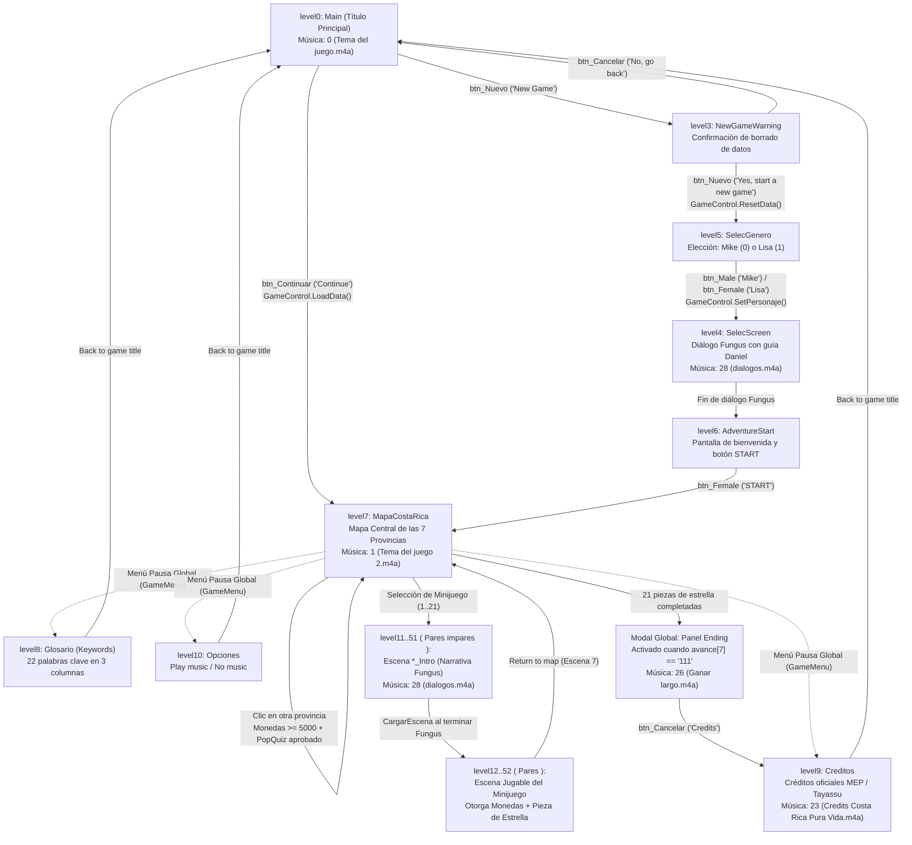

# REPORTE FASE 4: Especificación Funcional (GDD Inverso) y Arquitectura de Datos JSON

**Proyecto:** *Costa Rica Pura Vida in Many Ways* (MEP, 2018)  
**Fase:** 4 — Especificación Funcional (GDD Inverso) y Modelado de Base de Conocimiento Estática en JSON  
**Generador Automatizado:** [build_json_database.mjs](file:///c:/xampp/htdocs/costa_rica_puravida_in_many_ways/app/reverse_engineering/build_json_database.mjs)  
**Directorio de Salida JSON:** `c:\xampp\htdocs\costa_rica_puravida_in_many_ways\app\src\data\`

---

## 1. Resumen Ejecutivo y Hallazgos Críticos de la Fase 4

Durante la ejecución de la Fase 4 se cruzaron los catálogos binarios extraídos en la Fase 2 (`scenes_index.json`, `scenes_hierarchy/level0.json..level53.json`, `popquiz_database.json`, `fungus_dialogues.json`, `sprites_catalog.json`, `textures_catalog.json`, `audio_catalog.json`, `fonts_catalog.json`) con la decompilación estática IL2CPP/C# de la Fase 3 (`dump.cs`, `game_only_decompiled.txt`, `string_literals.json`, `ui_events_map.json`) y los archivos serializados crudos `unpacked_data/level0..level53`.

### 1.1 Hallazgos Técnicos Clave Resueltos en Fase 4
1. **Recuperación del 100% de Textos UI (`UnityEngine.UI.Text`) mediante Corrección de Alineación Binaria (`+56` bytes):**
   - En los archivos serializados de Unity 5.6.3f1 (formato v17), la estructura `FontData` dentro de `UnityEngine.UI.Text` ocupa exactamente **56 bytes** (y no 52 bytes) debido a que los campos booleanos `m_AlignByGeometry` y `m_RichText` están alineados individualmente a fronteras de 4 bytes antes de la cadena `m_Text`.
   - El script [build_json_database.mjs](file:///c:/xampp/htdocs/costa_rica_puravida_in_many_ways/app/reverse_engineering/build_json_database.mjs) corrige este desplazamiento, actualiza los 54 archivos `scenes_hierarchy/level0.json..level53.json` in-place y extrae el 100% de las etiquetas de botones, títulos, advertencias, créditos, glosario (`Keywords`) y paneles de recetas culinarias.
2. **Reconstrucción Exacta de `Music_Handler.Songs` (29 Pistas) y `Sound_Handler.sounds` (62 Ranuras de Audio):**
   - Se decodificaron directamente los componentes `MonoBehaviour` `Music_Handler` (`componentPathID: 365`, offset `+56`) y `Sound_Handler` (`componentPathID: 366`, offset `+68`) del objeto persistente `SoundControl` en `level0`, obteniendo el mapeo exacto de cada índice numérico invocado por `Music_Handler.playMusic(int)` y `Sound_Handler.playsound(int)` hacia su archivo `.m4a` real.
3. **Mapeo Completo de las 21 Piezas de Estrella (`starPieceIndex` `0`, `1`, `2` por Provincia):**
   - Se verificó en binario y en código decompilado (`RegisterStar.RegisterComplete`, `TayassuGames.FinishCollider.OnTriggerEnter2D` y llamadas directas a `GameControl.RegisterMinigameProgress`) qué pieza de estrella (`0 = izquierda`, `1 = centro`, `2 = derecha`) otorga cada uno de los 21 minijuegos.
4. **Descubrimiento de la Máquina de Estados del Final del Juego (`avance[7]` / `"MapaCR"`):**
   - El arreglo `GameControl.instance.avance` tiene **8 elementos** (`CRPVMW_level_0` a `CRPVMW_level_7`). Los índices `0..6` corresponden a las 7 provincias y el índice `7` (`name = "MapaCR"`) actúa como bandera de finalización global:
     - Inicia en `"000"`.
     - Cuando las 7 provincias (`0..6`) tienen sus 3 caracteres distintos de `'0'` (`"111"` en las 7 provincias = 21 estrellas), `GameControl.RegisterMinigameProgress` cambia automáticamente `avance[7].level` de `"000"` a `"111"`.
     - Al regresar a `MapaCostaRica` (`level7`), `GameEnding.CheckEnding()` detecta `avance[7].level == "111"`, lo actualiza a `"222"`, guarda en `localStorage`, despliega el modal `Panel Ending` (*"Hope you have enjoyed your stay in Costa Rica! We hope to see you back soon!"*) con las 7 estrellas completas y reproduce la pista musical `26` (`audio/Ganar (largo).m4a`).
5. **Discrepancia Documentada entre Código C# y Texto UI en el Costo de Viaje Provincial:**
   - El texto estático del modal `PanelConformarCambioRegion` en `level7` dice: *"Do you want to move to this province? You must spend 1000 coins to travel and answer a question."*
   - Sin embargo, el método compilado `PopQuiz.NewRegion()` (`asm: Gki`) verifica `GameControl.instance.GetMonedas() >= 5000` y descuenta `GameControl.instance.GastarMonedas(5000)`. Ambos valores han sido registrados explícitamente en [gameConfig.json](file:///c:/xampp/htdocs/costa_rica_puravida_in_many_ways/app/src/data/gameConfig.json) y [provinces.json](file:///c:/xampp/htdocs/costa_rica_puravida_in_many_ways/app/src/data/provinces.json).

---

## 2. Flujo Funcional Pantalla por Pantalla y Máquina de Estados (GDD Inverso)

### 2.1 Diagrama de Arquitectura de Navegación y Escenas

---

### 2.2 Especificación Pantalla por Pantalla

#### A. `level0` — `Main` (Pantalla de Título y Singleton Persistente `GameControl`)
- **Resolución Base:** `960 × 620` px (`CanvasScaler` referencia `800 × 600`).
- **Fondo y Logotipo:** `sprites/fondo.png` y `sprites/Logo Costa Rica Final Grande.png`.
- **Música de Fondo:** Índice `0` (`audio/Tema del juego.m4a`, duración `56.19s`).
- **Botones Principales (`sprites/boton_2.png`):**
  1. `btn_Nuevo` (**"New Game"**): Carga `level3` (`NewGameWarning`).
  2. `btn_Continuar` (**"Continue"**): Invoca `GameControl.LoadData()` y carga con pantalla de progreso `level7` (`MapaCostaRica`).
- **Jerarquía Persistente (`DontDestroyOnLoad`):**
  - `SoundControl`: Contiene 4 `AudioSource`, `Music_Handler` (29 canciones) y `Sound_Handler` (62 efectos/voces).
  - `GameControl` + `Game Contol UI`:
    - **`Panel Top` (Barra Superior HUD, color RGBA `[0.278, 0.608, 0.839, 1]`):**
      - Botón de menú principal (`btn_MenuPincipal`, `sprites/options_button.png`).
      - Contador de monedas (`img_ESmoneda`: `sprites/es-moneda.png` + `txt_monedaCounter`).
      - Iconos contextuales activables según el minijuego: `Doll Icon` (`sprites/doll-icon.png`), `Log Icon` (`sprites/logicon.png`), `Canasta` (`sprites/Tilemap_cafetal_32x32 V2_44.png` + `txt_basket`), `Flowers Icon` (`sprites/flores.png` + `Deliveries: 0/5`).
      - Botón de salir de minijuego (`CancelButton`, `sprites/boton_cerrar.png`).
    - **`Panel Menu Principal` (Modal de Pausa):**
      - Título: **"Main Menu"**, fondo `sprites/fondo_mid.png`.
      - Opciones: **"New Game"** (`sprites/newGame.png` → `level3`), **"Keywords"** (`sprites/icono_glosario.png` → `level8`), **"Credits"** (`sprites/icono_creditos.png` → `level9`), **"Options"** (`sprites/icono_creditos copy.png` → `level10`), **"Exit"** (`sprites/icono_exit.png` → `level0`).
    - **`Panel Cancel Game` (Confirmación de salida de minijuego):**
      - Texto: *"Do you want to exit the current game?"* | Botones: **"Yes"** (regresa a `level7` `MapaCostaRica`) / **"No"** (cierra el modal).
    - **`Panel Reload Game` (Modal de Reintento):**
      - Texto: *"Do you want to try again?"* | Botones: **"Yes"** (recarga escena actual) / **"Return to map"** (carga `level7`).
    - **`Panel Carga` (Pantalla de Transición Asíncrona):**
      - Texto: **"Loading"**, logo `sprites/Logo Costa Rica Final copy.png`, barra deslizante `sld_Carga`.
    - **`Panel Ending` (Modal de Victoria Final del Juego):**
      - Muestra las 7 estrellas de 3 piezas (`Star (1)` a `Star (7)` con `star_left.png`, `star_center.png`, `star_right.png`).
      - Mensaje: *"Hope you have enjoyed \nyour stay in Costa Rica!  \n\n\nWe hope to see you back soon!"*
      - Botón: **"Credits"** (`btn_Cancelar` → carga `level9`).

#### B. `level3` — `NewGameWarning` (Advertencia de Partida Nueva)
- **Texto Principal (`txt_Advertencia`):** *"Warning: starting a new game will delete all your previous data.\n\nAre you sure you want to go on?"*
- **Botones:**
  - `btn_Nuevo` (**"Yes, start a new game"**): Ejecuta `GameControl.ResetData()` (`_monedas = 5000`, `idPersonaje = false`, `_currentLocation = 0`, `avance[0..7] = "000"`, `WriteData()`) y carga `level5` (`SelecGenero`).
  - `btn_Cancelar` (**"No, go back"**): Regresa a `level0` (`Main`).

#### C. `level5` (` y duplicado en level53 `) — `SelecGenero` (Selección de Personaje)
- **Textos:**
  - `txt_Titulo 1`: *"Choose a \ncharacter"*
  - `txt_Titulo 2`: *"Please tell me.\nAre you a boy? \nOr are you a girl?"*
- **Tarjetas de Personaje:**
  - **Mike:** Retrato `sprites/mike_portrait.png`, cuerpo completo `sprites/Mike_1.png`, botón `btn_Male` (**"Mike"**) → llama `SetPersonaje(false)` (`0`) y carga `level4` (`SelecScreen`).
  - **Lisa:** Retrato `sprites/lisa_portrait.png`, cuerpo completo `sprites/Lisa_1.png`, botón `btn_Female` (**"Lisa"**) → llama `SetPersonaje(true)` (`1`) y carga `level4` (`SelecScreen`).

#### D. `level4` — `SelecScreen` (Encuentro Narrativo con el Guía Daniel)
- **Música:** Índice `28` (`audio/dialogos.m4a`).
- **Encabezado condicional:**
  - Si es Mike: *"Mike, Costa Rica it's a wonderful country, a lot of adventures waits!"*
  - Si es Lisa: *"Lisa, Costa Rica it's a wonderful country, a lot of adventures waits!"*
- **Secuencia Conversacional (`Fungus.Say`):**
  1. **Daniel** (`sprites/Daniel Taxi Driver.png`, `audio/MASTER MENU DANIEL 001.m4a`): *"Welcome to Costa Rica! My name is Daniel, What’s yours?"*
  2. **Mike / Lisa** (`audio/MASTER MENU MIKE 002.m4a` o `audio/MASTER MENU LISA 002.m4a`): *"Hi! Thanks, I'm Mike/Lisa. What places can I visit in Costa Rica?"*
  3. **Daniel** (`audio/MASTER MENU DANIEL 002.m4a`): *"Well, it depends on how long you are staying. You can walk around San José and visit the Gold Museum or if you’re planning to stay a bit longer, there are plenty of places to visit in the provinces."*
  4. **Mike / Lisa** (`audio/MASTER MENU MIKE OO3.m4a` o `audio/MASTER MENU LISA 003.m4a`): *"Let’s start with San José province!"*
- **Transición automática:** Al concluir el bloque Fungus, carga `level6` (`AdventureStart`).

#### E. `level6` — `AdventureStart` (Inicio de la Aventura)
- **Texto central (`txt_Titulo 1`):** *"Costa Rica is a wonderful country!\n\nLots of adventures await for you.\n\nLet's get started!"*
- **Botón:** **"START"** → Guarda estado inicial y carga `level7` (`MapaCostaRica`).

#### F. `level7` — `MapaCostaRica` (Mapa Central, Viajes, PopQuiz y Selección de Minijuegos)
- **Música:** Índice `1` (`audio/Tema del juego 2.m4a`, duración `83.58s`).
- **Mapa Base:** `sprites/mapa_cr2.png` (`sizeDelta: 1330 × 1132` dentro de un panel arrastrable `DraggablePanel`).
- **Pin del Jugador (`Player Position`):** Muestra `sprites/Lisa_4.png` o `sprites/Mike_4.png` sobre la provincia actual (`_currentLocation`), además del retrato `sprites/lisa_portrait.png` o `sprites/mike_portrait.png` en esquina.
- **Nodos de las 7 Provincias y Medidores de Estrella (`StarMeter`):**
  - Cada nodo (`NivelSanJose`, `NivelHeredia`, `NivelCartago`, `NivelAlajuela`, `NivelPuntarenas`, `NivelGuanacaste`, `NivelLimon`) tiene un marco `sprites/star_cero.png` con 3 sub-objetos: `Star Piece Left` (`index 0`), `Star Piece Center` (`index 1`) y `Star Piece Right` (`index 2`), que se activan según la cadena de 3 caracteres (`"000"`..`"111"`) de `avance[provinceId].level`.
- **Regla de Interacción al Hacer Clic en una Provincia (`PopQuiz.OnClick`):**
  1. **Si la provincia clicada ES la ubicación actual (`region == GameControl.instance.GetPlayerLocation()`):**
     - Reproduce sonido `38` (`audio/button.m4a`).
     - Si `avance[region].level == "000"`, reproduce la locución de bienvenida de la provincia según el género del jugador (`PopQuiz.WelcomeSound()`, índices `48..61`).
     - Abre directamente el panel de los 3 minijuegos de esa provincia (`MCR_MostrarJuegos.MostrarJuegos(region)`).
  2. **Si la provincia clicada NO es la ubicación actual:**
     - Abre el modal `PanelConformarCambioRegion` (*"Do you want to move to this province? You must spend 1000 coins to travel and answer a question."*).
     - Al pulsar **"Yes, let's go!"** (`PopQuiz.NewRegion`):
       - Verifica si `GetMonedas() >= 5000`.
       - Si **NO** alcanza: reproduce sonido `37` (`audio/wrong.m4a`) y abre `PanelAlerta` (*"You must get more coins to travel to new locations."*).
       - Si **SÍ** alcanza: descuenta `5000` monedas (`RestarMonedas(5000)` → sonido `35` `audio/coins.m4a`), elige una pregunta aleatoria del banco de esa provincia y abre `PanelPregunta`.
- **Evaluación de Trivia en `PanelPregunta` (`PreguntaController`):**
  - Muestra el escudo provincial (`img_Pregunta`), el enunciado en inglés (`txt_Pregunta`) y reproduce automáticamente la locución nativa `.m4a` (`QuestionAudio`).
  - **Modo Selección Única (`isMultipleChoice == false`):** Muestra de 2 a 6 botones directos (`Respuesta1..Respuesta6`). Al hacer clic en una opción:
    - Si es correcta (`scoreDelta = +1 >= minScore`): reproduce `36` (`audio/win-sound.m4a`), cambia `PlayerLocation` a la nueva provincia, guarda partida (`WriteData()`), reproduce el audio de bienvenida provincial (si está en `"000"`) y abre el panel de minijuegos de la provincia.
    - Si es incorrecta (`scoreDelta = -1 < minScore`): reproduce `37` (`audio/wrong.m4a`) y cierra `PanelPregunta` (el jugador permanece en la provincia anterior y pierde el peaje pagado).
  - **Modo Selección Múltiple (`isMultipleChoice == true`):** Muestra hasta 10 casillas de verificación (`tglRespuesta1..10`) en dos columnas y el botón **"Evaluate"** (`btnEvaluar`).
    - Cada casilla correcta marcada suma `+1` y cada casilla incorrecta marcada resta `-1` (`PreguntaController.OptionValue`).
    - Al pulsar **"Evaluate"** (`PreguntaController.Evaluar`), si `currentScore >= minScore` se aprueba el viaje; de lo contrario suena `37` (`wrong.m4a`) y se cierra el panel.

#### G. `level8` — `Glosario` (Pantalla de Vocabulario `"Keywords"`)
- **Música:** Índice `0` (`audio/Tema del juego.m4a`).
- **Título:** **"Keywords"** sobre `sprites/fondo.png`.
- **Contenido:** 3 columnas de vocabulario turístico y ecológico en inglés (22 términos oficiales del programa MEP):
  - **Columna 1:** `Waterfalls`, `Sea`, `Jungles`, `Volcanoes`, `Wildlife`, `Cloud forest`, `Beaches`, `Countryside`.
  - **Columna 2:** `National parks`, `Surfing`, `Watching Crocodiles`, `Hiking`, `Camping`, `Typical food`, `Bird watching`.
  - **Columna 3:** `Rafting on rivers`, `Canopy tours`, `Hot springs`, `Scuba diving`, `Sport fishing`, `Kayaking`, `Golfing`.
- **Botón Inferior (`btn_Cancelar`):** **"Back to game title"** → regresa a `level0`.

#### H. `level9` — `Creditos` (Créditos Oficiales)
- **Música:** Índice `23` (`audio/Credits Costa Rica Pura Vida.m4a`, duración `139.71s`).
- **Contenido:** Créditos institucionales del Ministerio de Educación Pública (MEP 2018), asesoría nacional de inglés (`Katherine Williams Jiménez`, `Marianella Granados Sirias`, `Alfredo Ortega Cordero`), Producciones de la Montaña (`Adrian Jurburg Gruskin`, `Dario Jurburg Chaves`, `Rosa Chinchilla`, `André Mendez`) y Tayassu Games (`Oscar Loria`, `Juan Navarro`, `Jean Arias`, `Gabriel Aguiar`, `Willbert Sibaja`, `Adrian Fernández`, `Antonio Loria`, `Kristoffer Vela`).
- **Botón Inferior (`btn_Cancelar`):** **"Back to game title"** → regresa a `level0`.

#### I. `level10` — `Opciones` (Configuración de Audio)
- **Música:** Índice `28` (`audio/dialogos.m4a`).
- **Controles:**
  - `btn_playmusic` (**"Play music"**) → activa `Music_Handler.Instance.PlayMusic()`.
  - `btn_stopMusic` (**"No music"**) → ejecuta `Music_Handler.Instance.StopMusic()`.
  - `btn_Cancelar` (**"Back to game title"**) → regresa a `level0`.

---

## 3. Catálogo Maestro de Audio Global (`Music_Handler` y `Sound_Handler`)

### 3.1 Pistas Musicales (`Music_Handler.Songs`, Índices `0..28`)

| Índice | Nombre del Clip | Archivo Extraído (`.m4a`) | Duración (s) | Uso en el Juego |
| :---: | :--- | :--- | :---: | :--- |
| `0` | `Tema del juego` | `audio/Tema del juego.m4a` | 56.19 | Pantalla `Main` (`level0`) y `Glosario` (`level8`) |
| `1` | `Tema del juego 2` | `audio/Tema del juego 2.m4a` | 83.58 | Mapa de Costa Rica (`level7`) |
| `2` | `San Jose - Finca cafetalera` | `audio/San Jose - Finca cafetalera.m4a` | 145.11 | Minijuego `SJ_FincaCafetalera` (`level48`) |
| `3` | `San Jose - Museo del Oro` | `audio/San Jose - Museo del Oro.m4a` | 157.02 | Minijuego `SJ_Museo_Oro` (`level50`) |
| `4` | `San Jose - Rafting` | `audio/San Jose - Rafting.m4a` | 68.67 | Minijuego `SJ_Rafting` (`level52`) |
| `5` | `Heredia - Reparto de flores` | `audio/Heredia - Reparto de flores.m4a` | 136.00 | Minijuego `HD_Entregar_Flores` (`level30`) |
| `6` | `Heredia - Mascarada 2` | `audio/Heredia - Mascarada 2.m4a` | 14.30 | Minijuego `HD_Mascarada` (`level32`) |
| `7` | `Heredia - Mountain Bike` | `audio/Heredia - Mountain Bike.m4a` | 58.36 | Minijuego `HD_Mountainbike` (`level34`) |
| `8` | `buceo_mixdown` | `audio/buceo_mixdown.m4a` | 174.63 | Minijuego `GN_Buceo` (`level26`) |
| `9` | `Guanacaste - Surf` | `audio/Guanacaste - Surf.m4a` | 67.23 | Minijuego `GN_Surf_Tamarindo` (`level28`) |
| `10` | `Guanacaste - Barra Honda` | `audio/Guanacaste - Barra Honda.m4a` | 79.38 | Minijuego `GN_BarraHonda` (`level24`) |
| `11` | `Sanatorio_mix Final` | `audio/Sanatorio_mix Final.m4a` | 150.05 | Minijuego `CT_Sanatorio_Duran` (`level18`) |
| `12` | `Cartago - Volcanes` | `audio/Cartago - Volcanes.m4a` | 66.30 | Minijuegos `CT_Volcanes` (`level20`) y `CT_Volcanes2` (`level22`) |
| `13` | `Sanatorio_mix Final` | `audio/Sanatorio_mix Final.m4a` | 150.05 | Reserva secundaria Sanatorio Durán |
| `14` | `Limon - Cocinar` | `audio/Limon - Cocinar.m4a` | 110.44 | Minijuego `Lm_Cocina` (`level36`) |
| `15` | `Limon - Tortuguero` | `audio/Limon - Tortuguero.m4a` | 69.90 | Minijuego `LM_Tortuguero` (`level38`) |
| `16` | `Limon - Desove` | `audio/Limon - Desove.m4a` | 100.81 | Minijuego `LM_Desove` (`level40`) |
| `17` | `Alajuela - Correr` | `audio/Alajuela - Correr.m4a` | 82.35 | Minijuego `AL_Correr` (`level14`) |
| `18` | `Alajuela - Bicicleta` | `audio/Alajuela - Bicicleta.m4a` | 82.35 | Minijuego `AL_Ciclismo` (`level12`) |
| `19` | `Alajuela - Nadar` | `audio/Alajuela - Nadar.m4a` | 82.35 | Minijuego `Al_Natacion` (`level16`) |
| `20` | `Puntarenas - Manuel Antonio` | `audio/Puntarenas - Manuel Antonio.m4a` | 61.49 | Minijuego `PR_Manuel_Antonio` (`level42`) |
| `21` | `Puntarenas -Churchill` | `audio/Puntarenas -Churchill.m4a` | 72.07 | Minijuego `PR_Paseo_Turistas` (`level44`) |
| `22` | `Puntarenas - Tarcoles` | `audio/Puntarenas - Tarcoles.m4a` | 59.16 | Minijuego `PR_Tarcoles` (`level46`) |
| `23` | `Credits Costa Rica Pura Vida` | `audio/Credits Costa Rica Pura Vida.m4a` | 139.71 | Pantalla `Creditos` (`level9`) |
| `24` | `Ganar (corto)` | `audio/Ganar (corto).m4a` | 8.07 | Fanfarria corta de victoria |
| `25` | `Perder (corto)` | `audio/Perder (corto).m4a` | 9.74 | Fanfarria corta de derrota |
| `26` | `Ganar (largo)` | `audio/Ganar (largo).m4a` | 40.07 | Victoria de minijuego y `Panel Ending` |
| `27` | `Perder (largo)` | `audio/Perder (largo).m4a` | 48.08 | Pantalla de derrota (`LM_Desove`, etc.) |
| `28` | `dialogos` | `audio/dialogos.m4a` | 43.94 | Todas las escenas `*_Intro`, `SelecScreen` y `Opciones` |

### 3.2 Efectos de Sonido y Locuciones de Bienvenida (`Sound_Handler.sounds`, Índices `29..61`)

| Índice | Nombre del Clip | Archivo Extraído (`.m4a`) | Duración (s) | Evento Asociado |
| :---: | :--- | :--- | :---: | :--- |
| `29` | `pickup` | `audio/pickup.m4a` | 0.34 | Recolección de objeto |
| `30` | `boom` | `audio/boom.m4a` | 2.91 | Colisión / Explosión / Erupción |
| `31` | `door` | `audio/door.m4a` | 2.80 | Apertura de puerta en `CT_Sanatorio_Duran` |
| `32` | `ghostlymoan` | `audio/ghostlymoan.m4a` | 3.00 | Aparición espectral en `CT_Sanatorio_Duran` |
| `35` | `coins` | `audio/coins.m4a` | 0.74 | Ganar o gastar monedas (`GanarMonedas` / `GastarMonedas`) |
| `36` | `win-sound` | `audio/win-sound.m4a` | 1.72 | Respuesta correcta en `PopQuiz` / Acierto |
| `37` | `wrong` | `audio/wrong.m4a` | 0.75 | Respuesta incorrecta en `PopQuiz` / Sin monedas |
| `38` | `button` | `audio/button.m4a` | 0.14 | Clic de botón estándar en UI y Mapa |
| `39` | `buttonReverse` | `audio/buttonReverse.m4a` | 0.14 | Botón de retroceso / Cerrar panel |
| `40` | `Camara V4` | `audio/Camara V4.m4a` | 1.81 | Obturador fotográfico submarino en `GN_Buceo` |
| `41` | `Nadar` | `audio/Nadar.m4a` | 0.41 | Brazada de natación en `Al_Natacion` |
| `42` | `lightsOff` | `audio/lightsOff.m4a` | 3.74 | Corte de luz en `CT_Sanatorio_Duran` |
| `43` | `raspar` | `audio/raspar.m4a` | 5.00 | Raspado de hielo en `PR_Paseo_Turistas` (Churchill) |
| `44` | `coger_cafe` | `audio/coger_cafe.m4a` | 0.71 | Recolección de grano de café en `SJ_FincaCafetalera` |
| `45` | `Motor Bote` | `audio/Motor Bote.m4a` | 5.00 | Motor de lancha en `LM_Tortuguero` |
| `46` | `rat` | `audio/rat.m4a` | 2.75 | Efecto ambiental en `CT_Sanatorio_Duran` |
| `47` | `crowd` | `audio/crowd.m4a` | 6.77 | Ovación en meta de carreras (`HD_FinishRace`) |
| `48` / `49` | `welcome alajuela male/fem` | `audio/welcome alajuela *.m4a` | 1.55 / 1.64 | Bienvenida provincial a Alajuela (`id: 3`) |
| `50` / `51` | `welcome to cartago male/fem` | `audio/welcome to cartago *.m4a` | 1.41 / 1.59 | Bienvenida provincial a Cartago (`id: 2`) |
| `52` / `53` | `welcome san jose male/fem` | `audio/welcome san jose *.m4a` | 1.40 / 1.57 | Bienvenida provincial a San José (`id: 0`) |
| `54` / `55` | `welcome puntarenas male/fem` | `audio/welcome puntarenas *.m4a` | 1.93 / 1.59 | Bienvenida provincial a Puntarenas (`id: 4`) |
| `56` / `57` | `welcome limon male/fem` | `audio/welcome limon *.m4a` | 1.45 / 1.39 | Bienvenida provincial a Limón (`id: 6`) |
| `58` / `59` | `welcome heredia male/fem` | `audio/welcome heredia *.m4a` | 1.43 / 1.61 | Bienvenida provincial a Heredia (`id: 1`) |
| `60` / `61` | `welcome guanacaste male/fem` | `audio/welcome guanacaste *.m4a` | 1.59 / 1.69 | Bienvenida provincial a Guanacaste (`id: 5`) |

---

## 4. Especificación de las 7 Provincias y los 21 Minijuegos

### 4.1 Tabla Maestro de Provincias y Distribución de Piezas de Estrella (`starPieceIndex`)

| ID | Provincia | Clave `localStorage` | Escudo | Bienvenida Audio (F / M) | Preguntas `PopQuiz` | Pieza `0` (`star_left`) | Pieza `1` (`star_center`) | Pieza `2` (`star_right`) |
| :-: | :--- | :--- | :--- | :---: | :---: | :--- | :--- | :--- |
| `0` | **San José** | `CRPVMW_level_0` | `EscudoSanJosé.png` | `53` / `52` | 10 | `SJ_FincaCafetalera` (*Coffee Farming*) | `SJ_Museo_Oro` (*Find the "Museo del Oro"*) | `SJ_Rafting` (*Rafting*) |
| `1` | **Heredia** | `CRPVMW_level_1` | `EscudoHeredia.png` | `59` / `58` | 10 | `HD_Mascarada` (*Masquerade Parade*) | `HD_Entregar_Flores` (*Delivering Flowers*) | `HD_Mountainbike` (*Mountain Biking*) |
| `2` | **Cartago** | `CRPVMW_level_2` | `EscudoCartago.png` | `51` / `50` | 9 | `CT_Sanatorio_Duran` (*Sanatorio Durán*) | `CT_Volcanes` (*Volcanoes Challenge*) | `CT_Volcanes2` (*Volcanoes of Costa Rica*) |
| `3` | **Alajuela** | `CRPVMW_level_3` | `EscudoAlajuela.png` | `49` / `48` | 10 | `AL_Ciclismo` (*Biking Race*) | `AL_Correr` (*Running Race*) | `Al_Natacion` (*Swimming Race*) |
| `4` | **Puntarenas** | `CRPVMW_level_4` | `EscudoPuntarenas.png` | `55` / `54` | 10 | `PR_Paseo_Turistas` (*Churchill Express*) | `PR_Manuel_Antonio` (*Picnic in Manuel Antonio*) | `PR_Tarcoles` (*Let's clean Tárcoles River*) |
| `5` | **Guanacaste** | `CRPVMW_level_5` | `EscudoGuanacaste.png` | `61` / `60` | 9 | `GN_Buceo` (*Playas del Coco Diving*) | `GN_Surf_Tamarindo` (*Tamarindo Surfing*) | `GN_BarraHonda` (*Barra Honda Caverns*) |
| `6` | **Limón** | `CRPVMW_level_6` | `EscudoLimon.png` | `57` / `56` | 10 | `Lm_Cocina` (*Caribbean Cuisine*) | `LM_Tortuguero` (*Tortuguero Boat Trip*) | `LM_Desove` (*Saving Turtles*) |

---

### 4.2 Desglose Funcional de los 21 Minijuegos Compilados

#### Provincia 0: San José
1. **`SJ_FincaCafetalera` — *Coffee Farming* (`level47` Intro / `level48` Juego | Pieza `0`):**
   - **Anfitriona:** María (`sprites/Maria Coffee.png`, banner `sprites/02-CoffeeFarm.png`).
   - **Mecánica:** Recolección top-down de café durante `120 segundos` (`SJ_FC_ControladorTiempo`). El jugador lleva un canasto con capacidad máxima de `20 granos` (`Your basket is full !`) que debe vaciar en la estación `Recibidor`.
   - **Puntaje por tipo de grano:** Grano Rojo maduro (`+10` monedas), Grano Amarillo (`+5` monedas), Grano Verde inmaduro (`-5` monedas). Sonido de recolección: `44` (`audio/coger_cafe.m4a`).
2. **`SJ_Museo_Oro` — *Find the "Museo del Oro"* (`level49` Intro / `level50` Juego | Pieza `1`):**
   - **Anfitriones:** Daniel y la curadora Maricela (`sprites/03-MuseoDelOro.png`).
   - **Mecánica:** Recorrido interactivo top-down por las **4 Salas de Exhibición** del Museo del Oro Precolombino (metalurgia en oro y tumbaga, chamanismo y jerarquía social, cerámica/esferas de piedra del Diquís y numismática/boletos de café). Incluye 37 bloques conversacionales `Fungus.Say` con audio nativo y monedas coleccionables en los pasillos.
3. **`SJ_Rafting` — *Rafting* (`level51` Intro / `level52` Juego | Pieza `2`):**
   - **Mecánica:** Descenso en balsa por los rápidos del río (`sprites/BG_SJ_Rafting.png`), esquivando rocas, troncos y remolinos mientras se recolectan monedas (`+50`). Al cruzar la meta (`TayassuGames.FinishCollider`) otorga la pieza de estrella `(0, 2, '1')` y bono por tiempo (`1000` a `2000` monedas).

#### Provincia 1: Heredia
4. **`HD_Mascarada` — *Masquerade Parade* (`level31` Intro / `level32` Juego | Pieza `0`):**
   - **Anfitrión:** Manuel Fernández (`sprites/Local Manuel Fernandez.png`, banner `sprites/mascarada.png`).
   - **Mecánica:** Runner lateral festivo por las calles de Barva de Heredia huyendo de los mantudos/mascaradas (`sprites/Giganta_anim_0.png`), saltando obstáculos urbanos y recolectando monedas hasta alcanzar `HD_WinCollider` (`+1000` monedas base + monedas recolectadas).
5. **`HD_Entregar_Flores` — *Delivering Flowers* (`level29` Intro / `level30` Juego | Pieza `1`):**
   - **Anfitriona:** Daniela Rose (`sprites/Floristeria Daniela Rose.png`).
   - **Mecánica:** Comprensión auditiva y lectora en inglés con exploración top-down de la "Ciudad de las Flores". El jugador conversa con los habitantes para conocer sus pedidos florales (rosas, girasoles, claveles, hortensias, orquídeas), recoge los ramos en la floristería de Daniela y completa las `5 entregas` (`Deliveries: 0/5` en el HUD superior). Otorga `2000` monedas y la pieza `(1, 1, '1')`.
6. **`HD_Mountainbike` — *Mountain Biking* (`level33` Intro / `level34` Juego | Pieza `2`):**
   - **Escenario:** Senderos montañosos del Bosque de la Hoja (`sprites/bosquehoja.png`).
   - **Mecánica:** Carrera de ciclismo de montaña con física de desplazamiento lateral, saltos sobre rocas/troncos y recolección de monedas hasta el `FinishCollider` `(1, 2, '1')`.

#### Provincia 2: Cartago
7. **`CT_Sanatorio_Duran` — *Sanatorio Durán* (`level17` Intro / `level18` Juego | Pieza `0`):**
   - **Escenario:** Antiguo Sanatorio Carlos Durán (`sprites/sanatorio.png`, música `audio/Sanatorio_mix Final.m4a`).
   - **Mecánica:** Aventura de exploración con cono de luz (`sprites/Transparecia sobre la cámara 1.png`) a través de los pabellones del hospital histórico fundado en 1918. El jugador resuelve una cadena de **6 misiones narrativas** (`numeroMision` `0..5`) interactuando con el espíritu del Dr. Carlos Durán, la Monja, la Niña y los pacientes (54 líneas de diálogo con voz en inglés) para desbloquear las puertas numeradas y salir del edificio.
8. **`CT_Volcanes` — *Volcanoes Challenge* (`level19` Intro / `level20` Juego | Pieza `1`):**
   - **Anfitrión:** Guardaparques Miguel Gutiérrez (`sprites/Guarda parques Miguel Gutierrez.png`).
   - **Mecánica:** Reto de reflejos e identificación geológica de 60 segundos a través de las fases de actividad de los 5 volcanes principales de Costa Rica (`Irazú`, `Turrialba`, `Poás`, `Arenal` y `Rincón de la Vieja`).
9. **`CT_Volcanes2` — *Volcanoes of Costa Rica* (`level21` Intro / `level22` Juego | Pieza `2`):**
   - **Anfitrión:** Guardaparques Miguel Gutiérrez (`sprites/Mapa Volcanes Fase 3.png`).
   - **Mecánica:** Segunda parte del desafío vulcanológico sobre el mapa de cordilleras volcánicas y anatomía de un volcán (*Magma Chamber*, *Main Vent*, *Crater*, *Lava Flow*, *Ash Cloud*). Otorga la pieza `(2, 2, '1')`.

#### Provincia 3: Alajuela (Triatlón en Lago Arenal / Laguna del Hule)
10. **`AL_Ciclismo` — *Biking Race* (`level11` Intro / `level12` Juego | Pieza `0`):**
    - **Mecánica:** Primera etapa del triatlón contra 6 competidores (`7` ciclistas en total). El jugador alterna carriles y presiona **"Pedal"** para cruzar la meta (`TayassuGames.HD_FinishRace`). Premios: `1st: 1000`, `2nd: 500`, `3rd: 100`, `4th: 50` monedas (quedar entre 1.º y 4.º lugar registra la estrella `(3, 0, '1')` y reproduce `audio/crowd.m4a`).
11. **`AL_Correr` — *Running Race* (`level13` Intro / `level14` Juego | Pieza `1`):**
    - **Mecánica:** Segunda etapa del triatlón (carrera pedestre con botón **"Run"** y animaciones `sprites/AnimsRunners_*.png`). Quedar entre 1.º y 4.º lugar otorga hasta `1000` monedas y la pieza `(3, 1, '1')`.
12. **`Al_Natacion` — *Swimming Race* (`level15` Intro / `level16` Juego | Pieza `2`):**
    - **Mecánica:** Tercera etapa del triatlón (natación en aguas abiertas con botón **"Swim"**, sprites `sprites/nadadores_*.png` y efecto `audio/Nadar.m4a`). Quedar entre 1.º y 4.º lugar otorga hasta `1000` monedas y la pieza `(3, 2, '1')`.

#### Provincia 4: Puntarenas
13. **`PR_Paseo_Turistas` — *Churchill Express* (`level43` Intro / `level44` Juego | Pieza `0`):**
    - **Anfitrión:** Copero Luis Araya (`sprites/Copero Luis Araya.png`, `sprites/Carrito Churchill.png`).
    - **Mecánica:** Gestión de tiempo de `120 segundos` en el Paseo de los Turistas. El jugador prepara granizados **Churchill** en el carrito (efecto `43` `audio/raspar.m4a`: hielo raspado, sirope rojo de kola, leche en polvo, leche condensada y helado) y los vende a los turistas en la playa antes de que se derritan (`200` monedas por Churchill vendido). Registra `(4, 0, '1')`.
14. **`PR_Manuel_Antonio` — *Picnic in Manuel Antonio* (`level41` Intro / `level42` Juego | Pieza `1`):**
    - **Anfitrión:** Guardaparques de Manuel Antonio (`sprites/Guarda parques 1_0.png`).
    - **Mecánica:** Patrullaje ecológico por la playa y senderos del Parque Nacional Manuel Antonio para concientizar a los turistas sobre no alimentar a los monos carablanca (`sprites/Mono_manuel_0.png`), mapaches e iguanas y resguardar los alimentos del picnic. Otorga `2000` monedas y registra `(4, 1, '1')`.
15. **`PR_Tarcoles` — *Let's clean Tárcoles River* (`level45` Intro / `level46` Juego | Pieza `2`):**
    - **Mecánica:** Plataformas y educación ambiental durante `90 segundos` en las riberas del río Grande de Tárcoles. El jugador recolecta bolsas de basura (`sprites/basura.png`) evitando a los cocodrilos americanos. Recompensa escalonada en `<EvaluateGame>c__Iterator0`: `>=20 bolsas: 5000`, `>=12 bolsas: 3000`, `>=5 bolsas: 1500` monedas, y registra `(4, 2, '1')`.

#### Provincia 5: Guanacaste
16. **`GN_Buceo` — *Playas del Coco Diving* (`level25` Intro / `level26` Juego | Pieza `0`):**
    - **Mecánica:** Buceo y fotografía submarina (`audio/Camara V4.m4a`) en los arrecifes de Playas del Coco (`sprites/elcoco.png`). Cada fotografía de fauna marina (`Pez Verde`, `Pez Azul`, `Pez Rojo`, `Pez Amarillo`, mantarrayas y tortugas) suma `500` monedas al llegar a la meta `GN_Buceo_Final` `(5, 0, '1')`.
17. **`GN_Surf_Tamarindo` — *Tamarindo Surfing* (`level27` Intro / `level28` Juego | Pieza `1`):**
    - **Mecánica:** Equilibrio y maniobras sobre las olas de Playa Tamarindo (`sprites/Guanacaste - Wave copia_0.png`), esquivando rocas y bañistas mientras se recolectan monedas hasta `GN_ST_Final` `(5, 1, '1')`.
18. **`GN_BarraHonda` — *Barra Honda Caverns* (`level23` Intro / `level24` Juego | Pieza `2`):**
    - **Anfitriona:** Guardaparques Ester Guevara (`sprites/Guarda parques Ester Guevara.png`).
    - **Mecánica:** Plataformas subterráneas en las cavernas calcáreas del Parque Nacional Barra Honda (`sprites/GNBH_Background2.png`), esquivando estalactitas, abismos y murciélagos (`sprites/GNBH_Bat01..04.png`) hasta encontrar la salida (*"You found the exit!"*, `(5, 2, '1')`).

#### Provincia 6: Limón
19. **`Lm_Cocina` — *Caribbean Cuisine* (`level35` Intro / `level36` Juego | Pieza `0`):**
    - **Mecánica:** Simulador culinario afrocaribeño con temporizador de `120 segundos`. Incluye una fase educativa previa con el recetario oficial y una despensa paginada de **34 ingredientes reales** que se arrastran a la olla (`sprites/olla.png`):
      1. **Caribbean Rice and Bean** (`sprites/Recetas e ingredientes_2.png`): `RedBeans`, `Water`, `GarlicAndOnion`, `PanamaPepper` (Habanero), `Thyme`, `BayLeaf`, `OliveOil`, `Salt_Pepper`, `CoconutMilk`, `UncookedRice`.
      2. **Patty** (`sprites/Recetas e ingredientes_0.png`): `GroundBeef`, `PanamaPepper`, `BrownBreadRolls`, `Thyme`, `GarlicAndOnion`, `CoconutOil`, `CoconutMilk`, `Salt_Pepper`, `SpecialDough`.
      3. **Rondón** (`sprites/Recetas e ingredientes_3.png`): `Yucca`, `CoconutOil`, `Yam`, `Carrot`, `Sweet potatoes`, `Fish`, `GarlicAndOnion`, `Ginger`, `CoconutMilk`, `CurryPowder`, `Salt_Pepper`.
      4. **Agua de Sapo** (`sprites/Recetas e ingredientes_1.png`): `Water`, `Yucca` (`Recetas e ingredientes_40.png` = Tapa de dulce / Brown cane sugar), `Ginger`, `LemonJuice`.
      5. **Pan Bon** (`sprites/Recetas e ingredientes_4.png`): `Flour`, `Water`, `Egg yeast`, `BrownSugar`, `Vanilla`, `Cinnamon`, `Nutmeg`, `CandiedFruit`, `Raisins`.
20. **`LM_Tortuguero` — *Tortuguero Boat Trip* (`level37` Intro / `level38` Juego | Pieza `1`):**
    - **Mecánica:** Navegación en lancha (`sprites/bote down_0.png`, sonido `45` `audio/Motor Bote.m4a`) por los canales del Parque Nacional Tortuguero esquivando troncos y recolectando monedas hasta avistar al manatí del Caribe (`LM_T_Manati`, `sprites/Manatee-Sheet2_0.png`), que registra `(6, 1, '1')`.
21. **`LM_Desove` — *Saving Turtles* (`level39` Intro / `level40` Juego | Pieza `2`):**
    - **Anfitriona:** Conservacionista Ana Cambronero (`sprites/Conservacionista Ana Cambronero.png`).
    - **Mecánica:** Defensa nocturna del desove de tortugas verdes en la playa de Tortuguero durante `90 segundos`. El jugador ahuyenta a los depredadores (`sprites/vulture-Sheet_0.png`) antes de que capturen a las `10 tortuguitas neonatas` (`objetives = 10`, `sprites/Tortu_pequenna-Sheet_7.png`). Sobrevivir hasta `0:00` otorga `2000` monedas (*"For you effort you earned 2000 coins!"*) y la pieza `(6, 2, '1')`.

---

## 5. Arquitectura y Esquema de la Base de Conocimiento JSON (`app/src/data/`)

Todos los archivos JSON fueron generados mediante [build_json_database.mjs](file:///c:/xampp/htdocs/costa_rica_puravida_in_many_ways/app/reverse_engineering/build_json_database.mjs) y están listos para ser importados de forma estática por la aplicación React:

| Archivo JSON | Tamaño | Contenido y Propósito en el Frontend React |
| :--- | :---: | :--- |
| [gameConfig.json](file:///c:/xampp/htdocs/costa_rica_puravida_in_many_ways/app/src/data/gameConfig.json) | `29.9 KB` | Configuración global (`960x620`), economía (`initialCoins: 5000`, `travelCostCoins: 5000`), claves `localStorage` (`CRPVMW_*`), personajes (`Lisa` y `Mike` con sprites y audios), los 29 temas musicales, los 35 efectos/voces activos, las 15 fuentes tipográficas y los textos/sprites de todos los modales globales. |
| [provinces.json](file:///c:/xampp/htdocs/costa_rica_puravida_in_many_ways/app/src/data/provinces.json) | `26.1 KB` | Las 7 provincias (`0..6`), escudos oficiales, coordenadas exactas `RectTransform` sobre el mapa `mapa_cr2.png`, audios de bienvenida masculino/femenino, descripciones culturales bilingües y vínculos a sus 3 minijuegos y piezas de estrella. |
| [popquiz.json](file:///c:/xampp/htdocs/costa_rica_puravida_in_many_ways/app/src/data/popquiz.json) | `188.8 KB` | Las **68 preguntas reales** organizadas tanto por provincia (`byProvince`) como en lista plana (`questions`), con `questionType` (`single` / `multiple`), `minScore`, opciones de respuesta (`isCorrect`, `scoreDelta: +1 / -1`) y ruta exacta al audio `.m4a` de la pregunta con su duración en segundos. |
| [minigames.json](file:///c:/xampp/htdocs/costa_rica_puravida_in_many_ways/app/src/data/minigames.json) | `325.7 KB` | Especificación exhaustiva de los **21 minijuegos activos** (más las **4 variantes** `CT_Basilica_Angeles`, `AL_Carretas`, `AL_Mariposario`, `AL_Juan_Santamaria`), incluyendo escenas `_Intro` y jugables, pistas musicales, controles, fórmulas de recompensa, todos los diálogos `Fungus.Say` introductorios e in-game con audios `.m4a`, todos los textos UI extraídos de cada escena, sprites asociados y `gameData` estructurado (recetas, ingredientes, salas, misiones, etc.). |
| [glossary.json](file:///c:/xampp/htdocs/costa_rica_puravida_in_many_ways/app/src/data/glossary.json) | `36.2 KB` | Los **22 términos clave oficiales (`Keywords`)** distribuidos en las 3 columnas exactas de la escena `Glosario` (`level8`) más **15 términos culturales, gastronómicos y ecológicos extendidos**, cada uno con traducción inglés/español, categoría, definición pedagógica, sprite y archivo de audio `.m4a`. |
| [dialogues.json](file:///c:/xampp/htdocs/costa_rica_puravida_in_many_ways/app/src/data/dialogues.json) | `191.7 KB` | Las **380 líneas conversacionales `Fungus.Say`** distribuidas en las 38 escenas narrativas, más los textos y créditos completos de `Main`, `NewGameWarning`, `SelecGenero`, `SelecScreen`, `AdventureStart`, `GameEnding` y `Creditos` (`level9`). |
| [assetsManifest.json](file:///c:/xampp/htdocs/costa_rica_puravida_in_many_ways/app/src/data/assetsManifest.json) | `402.6 KB` | Manifiesto indexado de los **895 sprites PNG**, **334 texturas PNG**, **422 clips de audio M4A** y **15 fuentes tipográficas** con dimensiones, puntos de pivote, duraciones y frecuencias de muestreo para precarga rápida en el navegador. |
